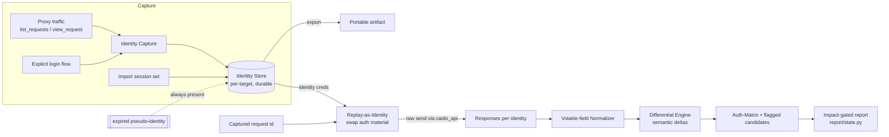
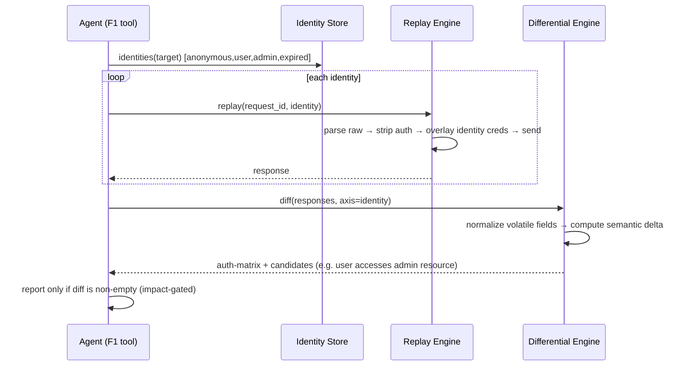

# Phase 1 — Identity State + Differential — Specification

> Spec-Architect PBT variant · Primitives **P1 + P2** · Feature **F1**.
> **Critical-path gate.** Source: `strix-bounty-roadmap.md` §2, §Phase 1. Program index: `specs/README.md`.

---

## Goal

Give the strix agent a durable, per-target store of multiple authenticated identities and a semantic response differ, so that **replaying any captured request across `anonymous → user → admin → expired` and diffing the results becomes a first-class agent action that emits an auth-matrix backed by concrete evidence**. Success = the agent can take any endpoint and produce an auth-matrix diff, and every IDOR/BFLA finding carries a cross-identity diff as proof.

---

## Architecture Overview

---

## User Stories

- **As the agent**, I store observed admin/user sessions so I can replay later requests as either role without re-auth.
- **As the agent**, I replay `GET /api/orders/42` across the identity ladder and receive a normalized diff so an access-control gap becomes a reportable candidate.
- **As the agent**, I get volatile fields ignored so identical responses do not produce false deltas.
- **As the operator**, I import a manually-captured session set so strix tests behind auth I configured.
- **As the operator**, every auth finding carries the exact cross-identity diff so I verify it in seconds.

---

## Specific Requirements

### Functional

| # | Requirement | Success criteria |
|---|---|---|
| F-1 | **Identity store** keyed per target; each identity = {role label, cookies, tokens, headers, provenance, freshness}. | Create/read/update/delete identities; survives container restart; two identities with the same role de-dupe. |
| F-2 | **Expired pseudo-identity** auto-present per target. | Every target's identity set always contains `expired`; it is never marked authorized. |
| F-3 | **Capture from proxy traffic.** | Given a captured authenticated request, an identity with its auth material is stored, labelled, redacted in summaries. |
| F-4 | **Capture from explicit login flow.** | Submitting valid credentials yields a stored identity carrying the post-login auth material. |
| F-5 | **Import / export.** | A target's identity set round-trips through a portable artifact (export → import → identical set, credentials intact). |
| F-6 | **Replay-as-identity.** | Replaying request `R` as identity `I` sends `R` with `I`'s auth material substituted (original auth stripped) and returns the parsed response. |
| F-7 | **Volatile-field normalizer.** | Declared volatile patterns (timestamps, CSRF, nonces, request-ids) are stripped/canonicalized before diffing; normalization is recorded. |
| F-8 | **Differential engine.** | Emits semantic deltas across axes identity/verb/token/state/header-set: status-class, body-structure, auth-signal, set-cookie, normalized-length. |
| F-9 | **F1 auth-matrix action.** | One agent tool replays `R` across the identity ladder and returns the matrix + pairwise diffs + flagged candidates. |
| F-10 | **Impact-gated evidence.** | A candidate is promotable to a finding only when accompanied by a non-empty P2 diff attached as evidence. |

### Non-Functional

| Aspect | Requirement |
|---|---|
| **Security** | Credential material per-target scoped, redacted in agent-visible output and logs, never written into report bodies, never cross-target. |
| **Determinism** | Normalizer + differ are pure/deterministic → reproducible, PBT-testable. |
| **Performance** | Replaying one request across a 4-rung ladder is a small bounded fan-out (4 sends + diffs); no global scan. |
| **Reliability** | Replay failures (network, expired-creds) are surfaced per-identity, never silently dropped from the matrix. |
| **Transparency (glass-box)** | Every matrix cell records the identity used and the fields normalized; nothing is a black-box verdict. |
| **Compatibility** | Built on `caido_api` replay primitives; does not break or duplicate `repeat_request`. |

---

## PBT Validation Strategy

**Tier-1 focused testing** (integration / behaviour): capture round-trip, import/export round-trip, replay substitutes the right auth material, auth-matrix shape, F1 flags a seeded IDOR fixture.

**Tier-2 Property-Based Testing** (security-critical, deterministic cores): the **differential engine**, the **volatile-field normalizer**, the **replay auth-substitution**, and the **identity-store scoping/redaction**. The diff engine can be PBT'd against synthetic response-pair fixtures **in parallel** with replay-engine development.

---

## Security Properties to Validate (∀ invariants)

These are validated as PBT properties before the security-audit gate.

1. **Identity isolation** — `∀ identities a ≠ b, ∀ request r: replay(r,a) and replay(r,b) → a recorded diff exists for the pair`. (Replaying as different identities is always a comparable, recorded event; identities never silently collapse.)
2. **IDOR detection** — `∀ resource owned by U, ∀ identity V ≠ U: successful access as V → flagged candidate`. (Any cross-owner success surfaces as an IDOR/BFLA candidate.)
3. **Expired-session safety** — `∀ session s: expired(s) → never authorized`. (strix never treats the expired pseudo-identity, or a session it marked expired, as authorized; a server that *does* authorize it is itself flagged.)
4. **Diff normalization stability** — `∀ response pair (x,y) differing only in volatile fields → semantic_diff(x,y) = ∅`. (Volatile-only differences never produce a delta → no false positives.)
5. **Credential scoping** — `∀ identity i of target T: creds(i) are visible only within T and never appear in agent-visible summaries or report bodies in cleartext`. (Redaction + per-target isolation hold for all identities.)
6. **Replay fidelity** — `∀ request r, identity i: replay(r,i) carries exactly i's auth material and none of r's original auth material`. (Substitution is total: no leakage of the captured request's own credentials.)

---

## Existing Code to Leverage

- `strix/tools/proxy/caido_api.py` — `parse_raw_request`, `apply_modifications`, `full_url_from_components`, `build_raw_request`, `replay_send_raw`, `parse_raw_response`: the replay-as-identity pipeline.
- `strix/tools/proxy/tools.py` — `list_requests` / `view_request` (capture source), `repeat_request` (modification-overlay pattern to extend with identity-aware auth swap), `_ctx_client` / JSON-return tool conventions.
- `strix/core/sessions.py` — `open_agent_session` / `SQLiteSession` durable per-id pattern to mirror for the per-target identity store.
- `strix/core/{paths,runner,inputs}.py` — durable store path + run wiring.
- `strix/report/state.py` — `ReportState`, `vulnerability_reports`: impact-gating sink for diff evidence.
- `strix/tools/{notes,todo,thinking,reporting}/` — `@function_tool` surface conventions for the new replay/diff/auth-matrix tools.
- `tests/test_core_paths.py` — Tier-1 regression-test pattern to mirror.

---

## Out of Scope

- **Automated credential discovery / cracking / enumeration** — strix replays identities it is given or observes; it does not obtain them.
- **Captcha / MFA-challenge solving** — login capture targets standard credential POST flows; harder flows fall back to operator import.
- **Cross-target identity sharing / finding-memory** — per-engagement only (program-level deferral, advice #14).
- **OOB confirmation (P3), inventory (P3/F3), race harness (P4/F4)** — later phases; P1/P2 only expose the substrate they consume.
- **Non-Caido capture backends** — Caido proxy is the capture substrate for this phase.

---

## Quality Gate 1 (design-principle alignment)

| Question | Answer |
|---|---|
| Enhances human capability? | Yes — amplifies the operator's reach into stateful, multi-identity auth testing instead of replacing judgement. |
| Supports focus / avoids distraction? | Yes — impact-gating + diff normalization suppress false deltas so attention lands on real IDOR/BFLA. |
| Transparent (glass-box)? | Yes — every matrix cell records identity used + fields normalized; the agent proposes, the deterministic differ disposes, the diff is the inspectable evidence. |

**Gate 1: PASS.** Proceed to tasks.
