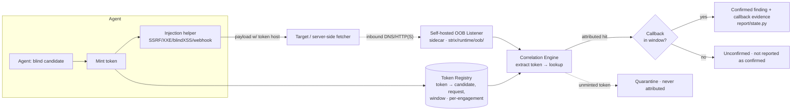
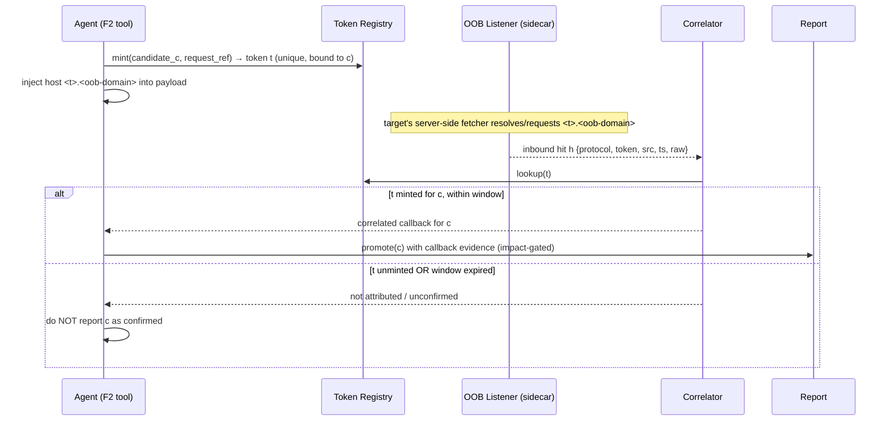

# Phase 2 — Native OOB Oracle — Specification

> Spec-Architect PBT variant · Primitive **P3** · Feature **F2**.
> **Truth oracle** — keeps the LLM agent honest on blind classes. Source: `strix-bounty-roadmap.md` §2, §Phase 2 (advice #6, #7). Program index: `specs/README.md`.

---

## Goal

Give the strix agent a **self-hosted OOB oracle** so that confirming SSRF, XXE, blind XSS, async callbacks, and webhook abuse becomes a first-class agent action: **mint a per-candidate callback token → inject it → the strix-owned listener captures any inbound DNS/HTTP(S) hit → the correlator attributes the hit to its candidate → the candidate is promoted to a confirmed finding only with that correlated callback as evidence**. Success = a blind-injection candidate is promoted **only** when a correlated callback is observed, and the false-positive rate on blind classes drops measurably (roadmap Phase 2 exit criteria).

---

## Architecture Overview

---

## User Stories

- **As the agent**, I mint a unique token bound to one SSRF candidate so any hit on it confirms exactly that candidate.
- **As the agent**, I inject a token host into an XXE entity and am told whether a DNS/HTTP callback fired, so I confirm with evidence.
- **As the agent**, a blind-XSS candidate stays unconfirmed until a browser calls back, so I never report XSS the app never executed.
- **As the operator**, the listener is self-hosted on a domain I control so no target data leaks to a third-party service.
- **As the operator**, every confirmed blind finding carries the captured callback (protocol, source IP, timestamp, token) so I verify it in seconds.

---

## Specific Requirements

### Functional

| # | Requirement | Success criteria |
|---|---|---|
| F-1 | **Self-hosted OOB listener (sidecar).** Captures inbound DNS + HTTP(S) interactions on a strix-controlled domain. | Listener starts as a sidecar (mirroring caido bootstrap), passes a readiness probe, and records each hit with {protocol, token-bearing FQDN/path, source IP, timestamp, raw request}. |
| F-2 | **Per-candidate token mint.** Mint a unique token bound to exactly one finding-candidate + originating request. | Each mint yields a unique injectable host `<token>.<oob-domain>` and a registry row; two mints never share a token. |
| F-3 | **Token registry.** Durable, per-engagement keyed store of mints and inbound hits. | Survives container restart within an engagement; keyed per engagement; no cross-engagement read path. |
| F-4 | **Correlation engine.** Attribute each inbound hit to its candidate via its token. | Hit with a minted token → attributed to that token's single candidate; hit with an unminted token → quarantined, never attributed. |
| F-5 | **Injection helpers.** Class-specific helpers template a minted host into SSRF/XXE/blind-XSS/async-callback/webhook payloads. | For each class, the helper returns a payload embedding the token host; the agent composes the surrounding request. |
| F-6 | **Confirmation gate (impact-gating).** Promote a candidate iff a correlated callback is observed within its window. | No correlated callback in window → candidate stays unconfirmed and is not reported as confirmed; a correlated callback → promotion with evidence. |
| F-7 | **Callback evidence in report.** Attach the correlated callback to the finding. | Confirmed finding's `vulnerability_report` carries the callback record (protocol, source, timestamp, token) as PoC; never a bare assertion. |
| F-8 | **F2 inject-and-confirm action.** One agent tool: mint → return host → await/poll → return correlated result or clean negative. | Tool returns a confirmed result (with evidence) on a fired token and an explicit *unconfirmed* on window expiry. |

### Non-Functional

| Aspect | Requirement |
|---|---|
| **Listener uptime** | The listener must be live before any token is minted; a readiness probe (mirroring `caido_bootstrap`) gates minting. Mints are rejected while the listener is down — never minted against a dead oracle. |
| **Correlation latency** | An inbound hit is correlated and surfaced to the agent within a small bounded delay (target: sub-second registry lookup + bounded poll interval); latency is measured and recorded per hit. |
| **Security** | Tokens are unguessable and minted only by strix; per-engagement scoped; unminted-token hits never attribute. No target data is sent to any third-party OOB service. |
| **Determinism** | Token registry + correlation function are pure/deterministic over (mint log, hit log) → reproducible, PBT-testable. |
| **Reliability** | A captured hit is never silently dropped; an absent callback is reported as *unconfirmed*, never as proof of safety. |
| **Transparency (glass-box)** | Every mint, hit, and correlation decision is recorded and inspectable; confirmation is evidence-backed, never a black-box verdict. |
| **Self-hosting** | Listener runs in `strix/runtime/oob/` sidecar; no dependency on hosted interactsh. |

---

## PBT Validation Strategy

**Tier-1 focused testing** (integration / behaviour): listener captures a synthetic DNS hit and a synthetic HTTP hit; mint produces a unique injectable host; an injected token end-to-end confirms a seeded SSRF fixture; window-expiry yields *unconfirmed*; report carries the callback evidence; an unminted-token hit is quarantined.

**Tier-2 Property-Based Testing** (security-critical, deterministic cores): the **token mint/registry** and the **correlation engine** are pure functions over mint/hit logs and are the primary PBT targets. Properties below are validated against synthetic mint-log/hit-log fixtures **in parallel** with listener-sidecar development.

---

## Security Properties to Validate (∀ invariants)

Validated as PBT properties before the security-audit gate.

1. **Token uniqueness / binding** — `∀ minted token t: t is unique ∧ t is bound to exactly one finding-candidate`. (No two candidates ever share a token; no token maps to two candidates.)
2. **Confirmation soundness** — `∀ candidate c: promoted(c) → ∃ correlated callback for c's token`. (Nothing is promoted without a real, attributed callback.)
3. **No-false-confirm** — `∀ candidate c: ¬observed(callback(c)) within window → ¬reported_as_confirmed(c)`. (Absence of a callback in the window blocks confirmation; absence is never reported as confirmed, and never asserted as safety.)
4. **Correlation correctness** — `∀ inbound hit h: attributed(h) → h.token was minted for that request/candidate`. (Attribution requires a prior mint; an unminted-token hit is never attributed.)
5. **Token unforgeability / scoping** — `∀ hit h of engagement E: attributed(h) → h.token ∈ mints(E)`. (A token minted in one engagement never confirms a candidate in another; unguessable tokens cannot be forged into attribution.)
6. **Live-oracle minting** — `∀ minted token t: listener_live_at(mint_time(t))`. (No token is ever minted against a down listener, so an absent callback always reflects the target, not a dead oracle.)

---

## Existing Code to Leverage

- `containers/Dockerfile` — already bundles `interactsh-client`, `dnsutils`, `netcat`, Go toolchain; the self-hosted listener runs in this same image with no new base tooling.
- `strix/runtime/caido_bootstrap.py` — in-container sidecar bootstrap + retry-readiness-probe pattern; direct template for the OOB listener bring-up.
- `strix/runtime/session_manager.py` — `create_or_reuse`, container-port constant, per-scan session cache; mirror for the listener port + lifecycle.
- `strix/runtime/docker_client.py` — `StrixDockerSandboxClient`: exposed-ports + `host.docker.internal` host-gateway + NET_ADMIN/NET_RAW caps; expose the listener's DNS/HTTP ports.
- `strix/runtime/backends.py` — `get_backend` / `_docker_backend` / `exposed_ports` plumbing to wire the listener ports.
- `strix/tools/proxy/tools.py` — `@function_tool`, `_ctx_client`, `_to_tool_json`, `_err`, JSON-return conventions for the new mint / poll / inject-and-confirm tools.
- `strix/report/state.py` — `add_vulnerability_report(...)` / `vulnerability_reports`: impact-gating sink for the callback evidence.
- `strix/core/sessions.py` — `SQLiteSession` durable per-id pattern to mirror for the durable token registry.
- `strix/core/{paths,runner,inputs}.py` — durable registry path + run wiring.
- `tests/test_core_paths.py` — Tier-1 regression-test pattern to mirror.

---

## Out of Scope

- **Third-party / hosted interactsh dependency** — `oast.fun` and public OOB servers are excluded; the listener is self-hosted only (no target data leaves to an external service).
- **Exploitation beyond confirmation** — P3 confirms that a callback fired; it does not weaponize SSRF into internal pivoting, escalate XXE to file exfiltration, or chain blind XSS into account takeover. Confirmation is the deliverable; deeper exploitation is the operator's call.
- **Operator DNS delegation / domain provisioning** — strix consumes a delegated OOB domain; registering it and setting NS records is an operator prerequisite (HTTP-only is the documented fallback).
- **Non-blind confirmation** — reflected/in-band classes are confirmed by the Phase 1 differential path, not OOB.
- **Automated payload generation for every sink type** — helpers template tokens into standard payload shapes; exhaustive WAF-evasion payload crafting is left to the agent.

---

## Quality Gate 1 (design-principle alignment)

| Question | Answer |
|---|---|
| Enhances human capability? | Yes — gives the operator OOB confirmation of blind classes they would otherwise have to set up and watch by hand; amplifies reach, not a replacement for judgement. |
| Supports focus / avoids distraction? | Yes — the confirmation gate suppresses every blind candidate that never called back, so operator attention lands only on confirmed, evidence-backed findings. |
| Transparent (glass-box)? | Yes — the agent proposes (injects), the deterministic listener + correlator dispose; every mint, hit, and correlation decision is recorded and the captured callback is the inspectable proof. |

**Gate 1: PASS.** Proceed to tasks.
