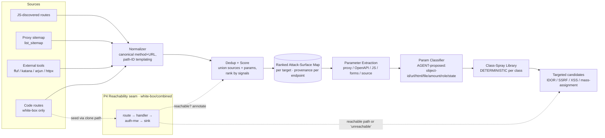
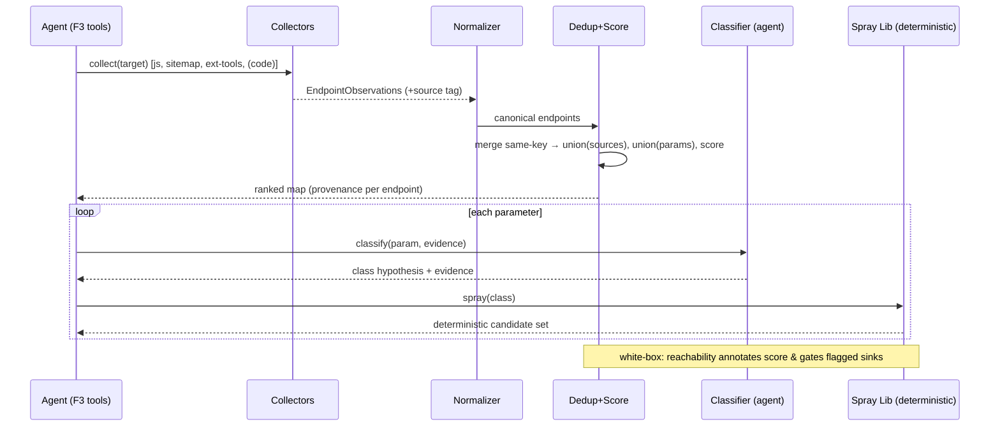

# Phase 3 — Unified Attack-Surface Inventory — Specification

> Spec-Architect PBT variant · Reachability seam **P4** · Feature **F3** (feeds all later phases).
> Source: `strix-bounty-roadmap.md` §Phase 3, §5 (P4), §1 principles. Program index: `specs/README.md`.

---

## Goal

Give the strix agent **one deduplicated, ranked attack-surface map per target** — endpoints correlated across JS routes, the proxy sitemap, external tools (`ffuf`/`katana`/`arjun`/`httpx`), and (white-box) code-discovered routes — with a **parameter-centric layer** where the agent classifies each parameter by type and a **deterministic class-specific spray** is applied per type, and a **P4 reachability seam** that (in white-box/combined mode) associates `route → handler → auth-middleware → sink` to filter noise. Success = a single ranked surface map with deduped endpoints (each carrying provenance) and classified parameters, where class-sprays emit targeted IDOR/SSRF/XSS/mass-assignment candidates, and white-box sinks are annotated reachable or explicitly unreachable. **The dedup + scoring is the deliverable; the collectors are plumbing.**

---

## Architecture Overview

---

## User Stories

- **As the agent**, I get one ranked surface map so I attack the highest-signal endpoints first, not overlapping source dumps.
- **As the agent**, each endpoint records its sources so I weight a multi-source hit above a single-source guess.
- **As the agent**, each param is classified and gets a deterministic spray for its class, so `object-id`→IDOR neighbours and `url`→SSRF callbacks fall out without hand-written payloads.
- **As the agent (white-box)**, routes link to handler/auth-mw/sinks so I skip unreachable code.
- **As the operator**, provenance + classification evidence are inspectable so recon is auditable.
- **As a downstream phase**, I draw a candidate set filtered by param class (`amount`/`state`) so I reuse F3 instead of re-deriving surface.

---

## Specific Requirements

### Functional

| # | Requirement | Success criteria |
|---|---|---|
| F-1 | **Source collectors** normalize JS / sitemap / external-tool / (white-box) code observations into a common `EndpointObservation` carrying a source tag. | Each of the 4 sources yields observations in one shape; every observation has exactly one source tag; external-tool collectors parse `ffuf`/`katana`/`arjun`/`httpx` output. |
| F-2 | **Normalizer** canonicalizes method+URL (host-case, default-port, trailing-slash, path-ID templating `/users/123→/users/{id}`, query-key order). | Two URLs differing only in canonicalizable noise produce the same endpoint key; every applied rule is recorded. |
| F-3 | **Dedup + score** merges same-key observations into one endpoint = union(sources) ∪ union(params), with a rank score from attack-surface signals. | One ranked map per target; a merged endpoint lists every source that found it; score reflects signals (auth-required, object-ref, state-changing verb, upload, source-multiplicity, reachable sink). |
| F-4 | **Provenance** recorded on every endpoint and parameter. | No endpoint/param appears in the map without ≥1 recorded source. |
| F-5 | **Parameter extraction** from proxy traffic, OpenAPI, JS, HTML forms, and (white-box) source. | Params attach to their endpoint with provenance + observed example values; same param from two sources de-dupes. |
| F-6 | **Parameter classification (agent-proposed)** into `object-id / url / html / file / amount / role / state`, recorded with its evidence. | Each param carries exactly one class + the evidence used; class is a recorded hypothesis, not a verdict. |
| F-7 | **Class-spray library (deterministic)** maps each class to a fixed spray set. | `object-id`→IDOR neighbours, `url`→SSRF/OOB targets, `html`→XSS probes, `file`→upload/traversal, `amount`→boundary/negative, `role`/`state`→privilege/transition; identical class ⇒ identical spray (no model output in payloads). |
| F-8 | **Framework-aware route parsers** for FastAPI, Flask/Django, Express/NestJS, Next.js, GraphQL. | Each top-stack parser extracts route+method (+param hints) from source; unrecognized stacks fall through to agent reasoning, not an error. |
| F-9 | **P4 reachability seam (white-box/combined)** associates `route → handler → auth-middleware → sink`. | When source is in scope, endpoints carry a reachability annotation (`reachable` w/ path · `unreachable` · `unknown`); a flagged sink always has a concrete path or is marked unreachable. |
| F-10 | **Agent tool surface** exposes collect / inventory / classify / spray / (white-box) reachability as `@function_tool`s returning JSON. | The agent can build the map, read the ranked endpoints, classify a param, and request its class-spray; black-box mode omits code collector + reachability cleanly. |

### Non-Functional

| Aspect | Requirement |
|---|---|
| **Determinism** | Normalizer, dedup, scoring, and spray library are pure/deterministic → reproducible, PBT-testable. Same evidence ⇒ same class-spray ⇒ same candidates. |
| **Agent-proposes/harness-disposes** | Classification is the only model-driven step; payload sets are deterministic. The model never invents *and* confirms (roadmap §1.2). |
| **Glass-box** | Provenance per endpoint/param, classification evidence, normalization rules applied, and reachability paths are all inspectable; nothing is a black-box ranking. |
| **Soundness (white-box)** | No unqualified "reachable": a flagged sink has a path or is `unreachable`/`unknown`. |
| **Scope safety** | Inventory bounded to in-scope hosts (`scope_rules`); collectors never expand surface outside scope; recon emits candidates only — no exploitation, impact-gating stays downstream. |
| **Performance** | Bounded fan-out: collectors run once per target; dedup/scoring are linear-ish in observation count; no per-request global rescans. |
| **Compatibility** | Builds on `list_sitemap`/`caido_api` + the clone path in `interface/utils.py`; does not duplicate existing proxy or diff-scope machinery. |
| **Component size** | Backend modules cohesive/single-responsibility; any TUI surface ≤ 400 lines. |

---

## PBT Validation Strategy

**Tier-1 focused testing** (integration / behaviour): each collector emits the common shape; normalizer collapses noise-equivalent URLs; a multi-source endpoint lists all sources; classification attaches one class + evidence; each class maps to its spray; a top-stack parser extracts a known route; white-box reachability annotates a seeded handler/sink fixture; black-box mode omits the code path cleanly.

**Tier-2 Property-Based Testing** (deterministic cores — the real work): **dedup** (idempotence, provenance completeness), **scoring** (monotonicity), **classification** (determinism), and **reachability soundness** (white-box). These run against synthetic observation/param/route fixtures and can be PBT'd **in parallel** with collector/parser development.

---

## Security Properties to Validate (∀ invariants)

Validated as PBT properties before the security-audit gate.

1. **Dedup idempotence** — `∀ source set S: dedup(dedup(S)) = dedup(S)`. (Re-deduping a deduped map is a fixpoint; no endpoint splits or re-merges on a second pass.)
2. **Provenance completeness** — `∀ endpoint e ∈ map: sources(e) ≠ ∅`. (Every endpoint records ≥1 source; nothing appears without a recorded origin — and a merge carries the union of its inputs' sources.)
3. **Classification determinism** — `∀ param p with fixed evidence E: classify(p, E)` is stable. (Same evidence ⇒ same class on every run; the agent-proposed class is reproducible, so the downstream deterministic spray is reproducible.)
4. **Scoring monotonicity** — `∀ endpoints e₁,e₂ where signals(e₁) ⊋ signals(e₂) (strictly more attack-surface signals): score(e₁) ≥ score(e₂)`. (Adding an attack-surface signal never lowers an endpoint's rank.)
5. **Reachability soundness (white-box)** — `∀ flagged sink k: (∃ reachable path route→handler→k) ∨ marked_unreachable(k)`. (A flagged sink always carries a concrete reachable path or is explicitly marked unreachable; `reachable` is never unqualified.)
6. **Spray determinism** — `∀ class c: spray(c)` is a fixed set independent of model output. (The payload set for a class is deterministic; only the *choice of class* is agent-proposed — the agent-proposes/harness-disposes boundary holds.)

---

## Existing Code to Leverage

- `strix/tools/proxy/tools.py` — `list_sitemap`, `view_sitemap_entry`, `list_requests`, `view_request`, `scope_rules`; `_ctx_client` / `_to_tool_json` / `@function_tool` conventions: **sitemap collector**, **proxy-traffic param source**, scope bounding.
- `strix/tools/proxy/caido_api.py` — `list_sitemap_with_client`, `_clean_sitemap_metadata` / `_clean_sitemap_request_summary` (sitemap node shape), `parse_raw_request`, `parse_raw_response`, `full_url_from_components`: normalize observations + extract params.
- `strix/interface/utils.py` — `infer_target_type` (web / repository / local_code → black-box vs white-box), `clone_repository` + clone path, `RepoDiffScope` / `resolve_diff_scope_context`, localhost→gateway rewrite: **P4 reachability seeding** + endpoint normalization anchor.
- `strix/tools/web_search/tool.py` — `web_search` / sandboxed `_do_search` sanitized-return pattern: template for **external-tool collector wrappers** (`ffuf`/`katana`/`arjun`/`httpx`).
- `strix/tools/shell/` — sandboxed binary execution surface for the bundled recon tools (Phase 0 toolchain).
- `strix/report/state.py` — `ReportState`, `vulnerability_reports`: downstream impact-gating sink (candidates ≠ findings).
- `strix/tools/{notes,todo,thinking,reporting}/` — `@function_tool` / JSON-return conventions for the new collect/inventory/classify/spray tools.
- `strix/core/{paths,runner,inputs}.py` — durable per-target inventory store path + run wiring.
- `tests/test_core_paths.py` — Tier-1 regression-test pattern to mirror.

---

## Out of Scope

- **Long-tail framework parsers** — only FastAPI, Flask/Django, Express/NestJS, Next.js, GraphQL; every other stack is left to agent reasoning (program out-of-scope, roadmap §5 #9, §6 anti-pattern).
- **Exploit execution / finding promotion** — Phase 3 emits *candidates*; exploitation and impact-gating live downstream (F1/F4/F5 + `report/state.py`).
- **Credential discovery / authenticated crawling** — the inventory uses identities P1 captures (Phase 1); it does not obtain them.
- **Cross-target surface memory** — per-engagement only (program-level deferral, advice #14).
- **Vendoring recon tools** — collectors *parse* `ffuf`/`katana`/`arjun`/`httpx`; the binaries are bundled in Phase 0, not built here.
- **Full source-flow taint analysis** — the P4 seam associates route→handler→auth-mw→sink for reachability filtering, not a complete dataflow/taint engine.

---

## Quality Gate 1 (design-principle alignment)

| Question | Answer |
|---|---|
| Enhances human capability? | Yes — collapses N overlapping recon dumps into one ranked, auditable surface map so the operator's reach extends without replacing judgement. |
| Supports focus / avoids distraction? | Yes — dedup + scoring + (white-box) reachability filtering suppress noise so attention lands on the highest-signal endpoints, not scanner spew. |
| Transparent (glass-box)? | Yes — provenance per endpoint, recorded classification evidence, applied normalization rules, and concrete reachability paths; the agent proposes the param class, deterministic sprays/dedup/scoring dispose. |

**Gate 1: PASS.** Proceed to tasks.
