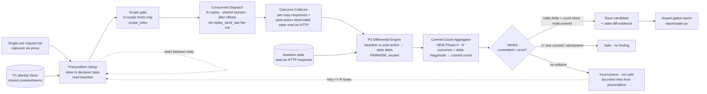

# Phase 4 — Race Condition Harness — Specification

> Spec-Architect PBT variant · Primitives **P1 + P2** (reused) · Feature **F4**.
> **Builds on Phase 1.** Reuses the P1 identity store and P2 differential engine (consistent naming). Self-contained.
> Source: `strix-bounty-roadmap.md` §Phase 4, advice #5. Program index: `specs/README.md`.

> **PM amendments (v1.1, pre-kickoff):** (1) P2 reuse boundary clarified — P2 produces the *pairwise* state delta; the *commit-count* aggregation over N copies is a named new Phase-4 component, **not** P2 and not a second differ (F-6/F-6b, TG3). (2) e2e race tests require a **deterministic (artificially widened) check-then-mutate window** in the seeded target so they are hermetic, not timing-flaky (PBT strategy, TG6). (3) explicit **scope gate** before the concurrent fan-out — the harness mutates live state (F-11, TG1). (4) **bounded-retry on `inconclusive`** before concluding (F-7, TG4). Phase 3 is now complete/merged, so the prior "runs in parallel with Phase 3" note is retired; its P1/P2 prerequisites are satisfied.

---

## Goal

Give the strix agent a deterministic **race harness** that fires **N concurrent copies of the same single-use request set** — shared session, slight timing offsets, from a declared precondition state — and uses the **P2 differential engine** to diff the resulting observable state (balances / orders / token validity) into a concrete state delta, from which a small Phase-4 **commit-count aggregator** decides whether the server allowed a single-use action **more than once**. Success = the harness reproduces a controlled double-redemption on a test target and reports the resulting **state delta as evidence**, and every race finding carries a concrete before/after state diff (impact-gated). The verdict is a pure function of observed state deltas; timing is the (non-deterministic) trigger, never the judge.

---

## Architecture Overview



```mermaid
sequenceDiagram
    participant Ag as Agent (F4 tool)
    participant Pc as Precondition Mgr (P1)
    participant Sc as Scope gate
    participant Dx as Concurrency Dispatcher
    participant Cx as Outcome Collector
    participant Df as P2 Differential Engine
    participant Ct as Commit-Count Aggregator (new)
    Ag->>Pc: setup(precondition, identity)  [e.g. balance=100, token unused]
    Pc->>Pc: drive target to state → read baseline (HTTP response)
    Ag->>Sc: dispatch(request_set, N, jitter, shared session)
    Sc->>Sc: assert target ∈ scope_rules (else refuse, no fan-out)
    Sc->>Dx: proceed
    par N concurrent copies
        Dx->>Dx: copy_i sent with jitter offset (shared cookies)
    end
    Dx-->>Cx: per-copy outcomes (no drops)
    Cx->>Cx: read post-action observable state (HTTP response)
    Cx->>Df: diff(baseline, post-action)  → pairwise state delta
    Df-->>Ct: state delta
    Cx-->>Ct: per-copy outcomes
    Ct->>Ct: commit count = f(N outcomes, delta magnitude)
    Ct-->>Ag: commit-count + state diff
    Ag->>Ag: verdict from deltas; bounded retry if inconclusive; report only if multi-commit (impact-gated)
    Note over Pc: reset to precondition before next trial / retry
```

---

## User Stories

- **As the agent**, I fire 5 concurrent copies of "redeem coupon C as user A" from one shared session and observe whether more than one redemption commits.
- **As the agent**, I read balance before/after and let the P2 differ produce the state delta, then a deterministic count decides the verdict — not my guess.
- **As the agent**, each trial starts from the exact declared precondition so a prior trial's mutation never masquerades as a race.
- **As the agent**, an idempotent/locked endpoint is reported *safe* even under concurrency, so I raise no noise on correctly-guarded actions.
- **As the agent**, when a trial shows no collision I retry from precondition up to a bounded count before concluding *inconclusive*, so a race that needs a few attempts to hit the window is not under-reported.
- **As the operator**, the harness refuses to fan out against an out-of-scope host, so concurrent live-state mutation only ever hits authorized targets.
- **As the operator**, every race finding carries the before/after observable-state diff so I verify the double-spend in seconds.
- **As Phase 5**, I call "run this set concurrently from this precondition; did it commit twice?" and reuse F4 instead of reinventing race testing.

---

## Specific Requirements

### Functional

| # | Requirement | Success criteria |
|---|---|---|
| F-1 | **Precondition setup (P1-backed).** | Given a declared precondition (e.g. `balance=100`, `token T unused`, `coupon C unredeemed`), the harness drives the target to it and records a captured **baseline** observable state before dispatch. |
| F-2 | **Precondition reset / isolation.** | Between independent trials, the harness resets to the same declared precondition; each trial provably starts from baseline. A trial that cannot reach the precondition is marked **inconclusive**, never safe, never dropped. |
| F-3 | **Concurrent dispatch.** | The harness fans out **exactly N** copies of the same request set, all carrying a single **shared** P1 session (cookies/tokens), and joins on all N. |
| F-4 | **Timing offsets (jitter).** | A bounded, configurable jitter window applies slight per-copy offsets to land copies in the server's check-then-mutate window. Jitter influences sensitivity only; it is **not** an input to the verdict. |
| F-5 | **Outcome collection.** | Every per-copy response (status, body, set-cookie) is collected with no drops, plus the **post-action observable state** read back from the target **as an HTTP response** (so it is `parse_raw_response`-able into the differ's input shape). |
| F-6 | **State diff (P2-backed, pairwise).** | The reused P2 differential engine (same normalizer) diffs **baseline vs. post-action observable state** (both HTTP responses) → a concrete **state delta**. P2 is the *pairwise* differ; it is **not** extended to count commits. |
| F-6b | **Commit-count aggregation (new Phase-4 component).** | A small, deterministic Phase-4 aggregator reduces the **N per-copy outcomes + the state-delta magnitude** (e.g. balance dropped by 3× a single redemption ⇒ 3 commits) to a **commit count**. This is **not** P2 and **not** a second differ — P2 stays the pairwise state differ; the aggregator only counts over P2's output + the outcomes. |
| F-7 | **Verdict (+ bounded retry).** | Commit-count > 1 (or a balance/order/token delta inconsistent with a single action) → **race candidate**; ≤ 1 commit / idempotent → **safe**; no observed collision → **inconclusive**, after which the harness **retries from the precondition up to a bounded R attempts** (R configurable, capped default) before finalizing *inconclusive*. Retry count is recorded. |
| F-8 | **Impact-gated evidence.** | A candidate is promotable to a finding only with the concrete before/after state-delta diff attached (`report/state.py`). No diff → no report. |
| F-9 | **F4 agent action.** | One agent tool: given request set + declared precondition + N + jitter, runs the harness and returns the per-copy outcome table, the state diff, the commit count, and the verdict. |
| F-10 | **Observable-state fallback.** | Where no observable read exists, per-copy commit signals are the fallback and the harness **records the absence of an independent oracle** (lower confidence, never a fabricated verdict). |
| F-11 | **Scope gate (pre-dispatch).** | Before any fan-out, the harness asserts the target is in scope (`scope_rules`); an out-of-scope target → **refuse to dispatch** (no concurrent requests sent), surfaced as a scoped refusal, never a silent skip. The harness mutates live state, so this gate is mandatory and precedes dispatch. |

### Non-Functional

| Aspect | Requirement |
|---|---|
| **Concurrency level** | N is an explicit, **bounded** input (capped default); the harness fans out exactly N, never an unbounded loop, and respects target rate limits (no DoS-shaped flooding). |
| **Retry bound** | Inconclusive retries are bounded (R capped default), rate-respecting, and reset to precondition between attempts; retries never escalate N or jitter beyond their configured caps. |
| **Jitter window** | Configurable, bounded per-copy offset window; default small. A tuning knob for collision probability, isolated from the verdict path. |
| **Scope safety** | All dispatch is gated to in-scope hosts (`scope_rules`, F-11); the harness never mutates state on a non-owned target; precondition setup is likewise scope-bounded. |
| **Repeatability** | A trial is repeatable: re-running from the same precondition with the same N/jitter is a valid retry; the **verdict is reproducible from the recorded state deltas** regardless of timing. |
| **Determinism (verdict)** | Both the P2 state delta and the commit-count aggregator are pure over observed outcomes/state → PBT-testable. Non-determinism is confined to the *trigger* (timing), never the *judgement*. |
| **Security** | Shared session credentials are per-target scoped, redacted in agent-visible output and logs, never written into report bodies (inherited from P1). |
| **Reliability** | Per-copy failures and unreachable preconditions are surfaced (failed / inconclusive), never silently dropped. |
| **Transparency (glass-box)** | Each run records N, jitter window, retry count, declared precondition, the scope decision, per-copy outcomes, and exactly which state read produced the diff. |
| **Compatibility** | Built on `caido_api` send primitives and the P1/P2 modules; does not duplicate `repeat_request`, the identity store, or the differential engine. The commit-count aggregator is new and small; it does not re-implement diffing. |

---

## PBT Validation Strategy

**Tier-1 focused testing** (integration / behaviour): precondition setup reaches and records baseline; reset returns to baseline between trials; the scope gate refuses an out-of-scope target before any fan-out; dispatch fans out exactly N copies sharing one session; outcome collection drops nothing; a seeded **double-redemption** fixture yields a multi-commit state delta + commit count > 1 and a candidate; a seeded **idempotent** endpoint yields *safe*; an inconclusive trial triggers bounded retry-from-precondition.

> **Deterministic test target (required for hermetic e2e — amendment 2).** The seeded double-redemption / idempotent fixtures must expose an **artificially widened, deterministic check-then-mutate window** (e.g. an explicit server-side sleep between the read and the commit), so the e2e race tests (TG6.1/6.2) reproduce the collision *every run* rather than probabilistically. The verdict PBTs already avoid live timing by running over synthetic tuples; this requirement keeps the *e2e* tests from becoming flaky gates (cf. the Phase 0 flaky-docker-test fix and the Phase 3 `/tmp` hermeticity cleanup).

**Tier-2 Property-Based Testing** (security-critical, deterministic cores): the **verdict function** (pure over state deltas) and the **commit-count aggregator** (pure over N outcomes + delta magnitude) and the **precondition isolation** logic. These can be PBT'd against **synthetic (baseline, post-action, outcome) tuples** — no live concurrency needed — **in parallel** with dispatcher development, exactly as Phase 1 PBT'd its differ against synthetic response pairs. The single-use-enforcement and determinism invariants are the primary PBT targets.

---

## Security Properties to Validate (∀ invariants)

Validated as PBT properties before the security-audit gate. State deltas are produced by the reused P2 engine; commit counts by the new aggregator.

1. **Single-use enforcement** — `∀ single-use precondition P with N concurrent redeems: at most one redeem commits, else the run is flagged`. (Any run where the server commits a single-use action more than once is a race candidate; a correctly-guarded action commits at most once.)
2. **Detection determinism** — `∀ two runs with identical observed state deltas + outcomes → identical commit count → identical verdict`. (The verdict is a pure function of observed deltas + counted outcomes; timing non-determinism never changes the judgement once they are fixed → reproducible reports.)
3. **No side effect on safe target** — `∀ idempotent / properly-locked endpoint E: harness(E) → reports no race`. (Concurrency against a guarded action yields *safe*, not a false positive; volatile-field noise normalized by P2 never fabricates a delta, and the aggregator counts ≤ 1.)
4. **Precondition isolation** — `∀ trial t (including retries): t starts from its declared precondition state`. (Reset holds across retries; no prior trial's/attempt's mutation bleeds into the next; a trial that cannot reach the precondition is *inconclusive*, never *safe*.)
5. **Scope-bounded dispatch** — `∀ dispatch d: target(d) ∈ scope_rules`. (No fan-out, and no state mutation, against an out-of-scope target; an out-of-scope request is refused before dispatch, never silently dropped.)

---

## Existing Code to Leverage

- **Phase 1 P1 identity store** (`strix/core/identity/`) — shared cookies/tokens for the concurrent copies; the identity/account that is the precondition subject. **Reused, not rebuilt.**
- **Phase 1 P2 differential engine** (`strix/core/diff/`, `diff()` + volatile-field normalizer) — produces the **pairwise** before/after state delta. **Reused, not rebuilt, and not extended to count commits.**
- `strix/tools/proxy/caido_api.py` — `parse_raw_request`, `build_raw_request`, `apply_modifications`, `replay_send_raw` (async), `parse_raw_response`: build N identical copies, dispatch concurrently, and parse the post-action state read into the differ's input shape.
- `strix/tools/proxy/tools.py` — `list_requests` / `view_request` (capture the single-use action), `scope_rules` (**the F-11 scope gate**), `repeat_request` overlay pattern, `_ctx_client` / JSON-return conventions; observable-state read-back.
- `strix/report/state.py` — `ReportState`, `vulnerability_reports`: impact-gating sink for the state-delta evidence.
- `strix/core/{paths,runner,inputs}.py` — per-target harness wiring + durable trial-record path.
- `strix/tools/{notes,todo,thinking,reporting}/` — `@function_tool` surface conventions for the new race-harness tool.
- `tests/test_core_paths.py` — Tier-1 regression-test pattern to mirror; use `tempfile`/`tmp_path` (not hardcoded `/tmp`, per the Phase 3 hermeticity lesson) for any trial-record fixtures.

---

## Out of Scope

- **Kernel-level / OS-scheduler timing manipulation** — the harness uses application-level jitter and concurrency only; it does not pin CPUs, manipulate the scheduler, or use kernel timing primitives.
- **Exploit weaponization** — the harness *demonstrates* a single-use violation as a state delta; it does not build a repeatable drain/exploit script or maximize stolen value.
- **Unbounded load / stress / DoS testing** — concurrency and retries are bounded and rate-respecting; throughput stress is not the goal.
- **Building a second differ or a second credential store** — diffing reuses P2 (pairwise); the commit-count aggregator counts over P2's output, it does not re-diff. Shared session material reuses P1.
- **Automated credential discovery** — identities come from P1 (observed/imported), not cracked here.
- **Distributed/multi-node race orchestration** — single-runtime async fan-out only.

---

## Quality Gate 1 (design-principle alignment)

| Question | Answer |
|---|---|
| Enhances human capability? | Yes — gives the operator a deterministic harness that reproduces TOCTOU races (double-spend, multi-use tokens) with concrete state-delta proof, instead of leaving the agent to speculate about "possible races." |
| Supports focus / avoids distraction? | Yes — impact-gating + the no-side-effect-on-safe-target invariant suppress false positives on guarded actions; bounded retries surface genuine races that need a few attempts without flooding. |
| Transparent (glass-box)? | Yes — every run records N, jitter, retry count, the declared precondition, the scope decision, per-copy outcomes, and the exact state read; the agent proposes the action, the deterministic verdict (pure over P2 state deltas + the commit count) disposes it, the diff is the inspectable evidence. |

**Gate 1: PASS.** Proceed to tasks.
