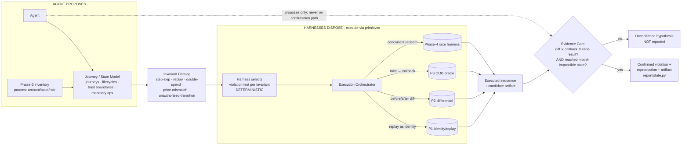
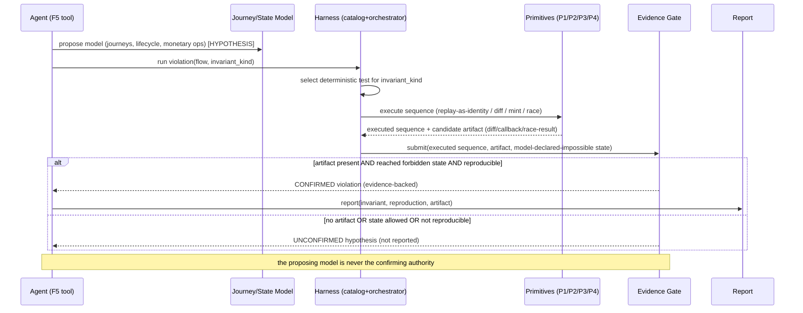

# Phase 5 — Business-Logic State Testing — Specification

> Spec-Architect PBT variant · Primitives **P1 + P2 + P3 + F3 + Phase-4 race harness** · Feature **F5**.
> **Terminal phase — highest ceiling, highest noise risk.** Consumes every earlier primitive. Source: `strix-bounty-roadmap.md` §Phase 5 (advice #4), §1.2, §6. Program index: `specs/README.md`.

---

## Goal

Give the strix agent a way to find **business-logic flaws** — step-skip, replay, double-spend, quantity/price mismatch, unauthorized state change — by **proposing a journey/state model** of the application (user journeys, object lifecycles, trust boundaries, monetary operations, approval/coupon/refund/credit/invite flows) and then letting **deterministic harnesses dispose**: each proposed invariant is attacked by a fixed violation test that *executes* a sequence and reports the resulting state. **Every reported violation carries a deterministic artifact — a P2 diff, a P3 callback, or a Phase-4 race result — and the model never self-confirms.** Success = a logic violation is reported **only** with a concrete reproduction (an executed sequence reaching a state the model declared impossible), never a plausible narrative (roadmap Phase 5 exit criteria).

---

## Architecture Overview

---

## User Stories

- **As the agent**, I propose a checkout model (steps, coupon one-time rule, price field) so the harness has a hypothesis to attack — recorded as a hypothesis, not a finding.
- **As the agent**, I ask the harness to execute a coupon double-redemption via the Phase-4 race harness so a real double-spend state, not my narration, decides reportability.
- **As the agent**, I tamper a price field and the orchestrator replays as the buyer (P1) and diffs the charged total (P2) so a price mismatch is backed by a concrete diff.
- **As the agent**, I drive a forbidden transition as an unauthorized identity and it confirms only via a P2 diff showing the transition succeeded, so I never report a transition the app blocked.
- **As the operator**, every logic finding carries an executed reproduction + a diff/callback/race-result so I re-run it and see the disallowed state in seconds.
- **As the operator**, proposed invariants stay visibly separate from confirmed violations so I can trust nothing was self-confirmed by the model.

---

## Specific Requirements

### Functional

| # | Requirement | Success criteria |
|---|---|---|
| F-1 | **Journey / state-model intake (agent-proposed schema).** Structured, recorded model: journeys (ordered steps), object lifecycles (states + allowed transitions), trust boundaries (identity ↔ step), monetary operations (amount/price/quantity relations), named flows (approval/coupon/refund/credit/invite). | Agent can submit/read a per-engagement model; every field is tagged `agent-proposed`; endpoints/params are referenced from the Phase-3 inventory, not re-derived; the model is durable per engagement and inspectable. |
| F-2 | **Invariant catalog (fixed).** Each invariant *kind* maps to one deterministic violation test: step-skip, replay, double-spend/race, quantity/price-mismatch, unauthorized-state-change. | The catalog is a fixed enumerable set; the agent selects *which* kind applies to a flow; the test for a kind is identical every run (no model output in the test logic). |
| F-3 | **Step-skip violation test.** Attempt to reach step N of a journey without completing step N−1, replayed as the modeled identity (P1). | Executes the out-of-order sequence and captures the response; a success that the model marked as requiring the prior step is a candidate (gated by P2 diff). |
| F-4 | **Replay violation test.** Re-submit a one-time action (coupon/token/approval) a second time. | Executes the second submission; a second success on a one-time action is a candidate (gated by P2 diff or Phase-4 race result). |
| F-5 | **Double-spend / race violation test (reuses Phase-4).** Concurrent redemption/withdrawal via the **Phase-4 race harness**, not a re-implementation. | Phase 5 invokes the Phase-4 harness with the modeled request set + identity; the harness's state-delta is the candidate artifact; Phase 5 adds no new concurrency code. |
| F-6 | **Quantity / price-mismatch violation test.** Tamper amount/price/quantity (params from Phase-3 `amount` class), re-derive expected total, replay as buyer (P1), diff charged result (P2). | Executes the tampered order; a charged total that contradicts the model's price relation is a candidate backed by the P2 diff. |
| F-7 | **Unauthorized-state-change violation test.** Drive a model-forbidden transition as a non-permitted identity (P1), or an async transition confirmed via callback (P3). | Executes the transition attempt; a transition the model marked forbidden that nonetheless succeeds is a candidate backed by a P2 diff (or P3 callback for async flows). |
| F-8 | **Execution orchestrator (wires P1/P2/P3/P4).** For (flow, invariant_kind), execute the violation sequence through the right primitives and record the executed sequence + resulting state. | One orchestrator entry per invariant kind; it calls P1 replay, P2 diff, P3 mint/await, or the Phase-4 harness as the kind requires; the full executed sequence is recorded for reproduction. |
| F-9 | **Evidence gate (hard control).** Promote a violation iff a deterministic artifact (P2 diff ∨ P3 callback ∨ Phase-4 race result) is attached **and** the executed sequence reached a state the model declared impossible. | No artifact ⇒ stays unconfirmed hypothesis, never reported; the gate accepts only typed artifacts, never the model's free-text rationale; reproduction re-runs to the same disallowed state. |
| F-10 | **Report integration (impact-gated) + F5 tool surface.** Confirmed violation writes a `vulnerability_report` (violated invariant + executed sequence + artifact); `@function_tool`s expose model intake, list-invariants, run-violation, read-gated-result. | A confirmed finding's report carries the reproduction and the backing artifact; unconfirmed hypotheses never reach `vulnerability_reports`; tools mirror `strix/tools/proxy` JSON-return conventions. |

### Non-Functional

| Aspect | Requirement |
|---|---|
| **Agent-proposes / harness-disposes** | Structural, not advisory: the proposing model is never on the confirmation path. Confirmation originates only from a deterministic harness artifact. The model invents; the harness disposes (roadmap §1.2, §6). |
| **Evidence-gating** | Non-negotiable: no diff ∨ callback ∨ race-result ⇒ not reportable. A violation is an *executed* sequence reaching a model-impossible state, never a static or narrative claim. |
| **Reproducibility** | Every reported violation re-runs to the same disallowed state; non-reproducible one-offs stay unconfirmed. |
| **Determinism** | The invariant catalog, each violation test's logic, and the evidence gate are pure/deterministic over (model, executed sequence, artifact) → PBT-testable. Only model *proposal* and invariant *selection* are agent-driven. |
| **Reuse over re-build** | Race = Phase-4 harness; identity/replay = P1; diff = P2; callback = P3; surface/params = Phase-3 inventory. Phase 5 adds intake, catalog, orchestrator, gate only. |
| **Scope safety** | Per-engagement model + violations only; no cross-target logic memory (advice #14). Surface bounded to the in-scope Phase-3 map. |
| **Glass-box** | Proposed model, chosen invariant, executed sequence, and backing artifact all recorded and inspectable; confirmation is never a black-box verdict. |
| **Performance** | Bounded fan-out: violation tests run per chosen flow, not a global rescan; double-spend fan-out is the Phase-4 harness's bounded concurrency. |
| **Component size** | Backend modules cohesive/single-responsibility; any TUI surface ≤ 400 lines. |

---

## PBT Validation Strategy

**Tier-1 focused testing** (integration / behaviour): model intake round-trips and tags fields `agent-proposed`; each violation test (step-skip / replay / price-mismatch / unauthorized-transition) flags a candidate on a seeded fixture; double-spend test invokes the Phase-4 harness and surfaces its state-delta; a candidate **with** a diff is confirmed; a candidate **without** any artifact is suppressed; a confirmed violation's report carries the reproduction + artifact.

**Tier-2 Property-Based Testing** (security-critical, deterministic cores — the real work): the **evidence gate** and the **no-self-confirmation** boundary are the primary PBT targets, validated against synthetic (model, executed-sequence, artifact) fixtures **in parallel** with orchestrator wiring. Reproducibility and invariant-violation soundness are PBT'd over executed-sequence fixtures.

---

## Security Properties to Validate (∀ invariants)

Validated as PBT properties before the security-audit gate.

1. **Evidence-gated reporting** — `∀ reported violation v: v carries a deterministic artifact (P2 diff ∨ P3 callback ∨ Phase-4 race result)`. (Nothing reaches `vulnerability_reports` without a typed, deterministic artifact attached — no narrative-only findings.)
2. **No self-confirmation** — `∀ proposed invariant I: confirmation(I) originates from a harness, never from the proposing model`. (The model that invents an invariant is structurally excluded from confirming it; the gate accepts only harness artifacts, never the model's rationale.)
3. **Reproducibility** — `∀ reported violation v: re-running v's harness reproduces the disallowed state`. (A confirmed violation is replayable to the same forbidden state; non-reproducible flukes are never confirmed.)
4. **Invariant-violation soundness** — `∀ flagged step-skip / double-spend / price-mismatch / unauthorized-transition: an executed sequence reaches a state the model declared impossible`. (Every flag is backed by a real run that lands in a model-forbidden state — not a static suspicion or a hypothetical.)
5. **Hypothesis isolation** — `∀ proposed model field f: tagged(f, agent-proposed) ∧ f never appears as a confirmed finding without passing the gate`. (Proposals stay proposals until a harness disposes; the proposed/confirmed boundary is recorded and never blurred.)
6. **Primitive-reuse fidelity** — `∀ double-spend test: execution is delegated to the Phase-4 race harness`; `∀ identity-driven step: replay is delegated to P1`. (Phase 5 composes primitives; it never re-implements concurrency, replay, diffing, or callback correlation — divergent copies are excluded.)

---

## Existing Code to Leverage

- **P1 (Phase 1)** — identity store + `replay-as-identity` + auth-matrix tool: drive journey steps and forbidden transitions as the modeled / unauthorized identity.
- **P2 (Phase 1)** — differential engine + volatile-field normalizer: **evidence type 1** (step-skip / unauthorized-transition / price-mismatch confirmation via non-empty diff).
- **P3 (Phase 2)** — OOB oracle (mint → correlated callback): **evidence type 2** (async / webhook / refund-callback logic confirmation).
- **Phase-4 race harness** — concurrent replay + state-delta: **evidence type 3** (double-spend / replay / multi-redeem); Phase 5 *invokes* it, never re-implements it.
- **F3 (Phase 3)** — ranked attack-surface inventory + param classes (`amount` / `state` / `role`): seeds the model with state-changing endpoints and monetary/state/role params.
- `strix/tools/proxy/caido_api.py` — `parse_raw_request`, `apply_modifications`, `build_raw_request`, `replay_send_raw`, `parse_raw_response`, `full_url_from_components`: drive/tamper/re-submit journey steps.
- `strix/tools/proxy/tools.py` — `@function_tool`, `_ctx_client`, `_to_tool_json`, `_err`, JSON-return conventions for the F5 tools.
- `strix/report/state.py` — `add_vulnerability_report(...)`, `vulnerability_reports`: impact-gating sink for the violated invariant + executed sequence + artifact.
- `strix/core/sessions.py` — `SQLiteSession` durable per-id pattern to mirror for the per-engagement model + confirmed-violation store.
- `strix/core/{paths,runner,inputs}.py` — durable model/violation store path + run wiring.
- `tests/test_core_paths.py` — Tier-1 regression-test pattern to mirror.

---

## Out of Scope

- **Generic invariant-modeling / inference framework** — the catalog is a fixed, small set of violation-test kinds and the model is an agent-proposed hypothesis; strix does not learn or infer invariants from a general solver (roadmap §6 anti-pattern: "plausible-but-wrong invariants").
- **Cross-target logic memory** — per-engagement model + violations only; reusing "this stack usually has coupon bugs" reintroduces confirmation bias (advice #14, §6).
- **Autonomous exploitation beyond confirmation** — Phase 5 confirms a disallowed *state* with evidence; it does not weaponize a double-spend into sustained fund extraction or chain a step-skip into account takeover. Confirmation is the deliverable; deeper exploitation is the operator's call.
- **Re-implementing earlier primitives** — concurrency (Phase-4), replay/identity (P1), diffing (P2), callback correlation (P3), and surface inventory (Phase-3) are consumed, not rebuilt.
- **Model auto-generation without agent proposal** — the journey/state model is an agent hypothesis; there is no automatic spec-to-model extractor here.

---

## Quality Gate 1 (design-principle alignment)

| Question | Answer |
|---|---|
| Enhances human capability? | Yes — surfaces the highest-value, hardest-to-automate bounty class (logic/financial) with a concrete reproduction, amplifying the operator's reach rather than replacing judgement. |
| Supports focus / avoids distraction? | Yes — the evidence gate suppresses every unconfirmed hypothesis, so the noisiest class still lands only confirmed, reproducible findings on the operator's attention. |
| Transparent (glass-box)? | Yes — the agent proposes the model, deterministic harnesses dispose; the proposed model, chosen invariant, executed sequence, and backing artifact are all recorded, and the model is structurally barred from confirming itself. |

**Gate 1: PASS.** Proceed to tasks.
