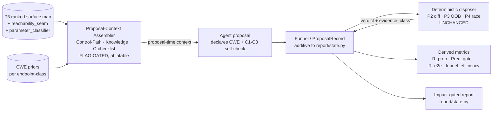

# Propose–Dispose Instrumentation — Specification

> Spec-Architect PBT variant · Feature **F-PD-A** · **Product-DAG `unit`** (telemetry + proposal-recall layer).
> Buildable, product-reusable half of the propose–dispose program. The research half (B-V2P corpus, experiments, ablation mode) is the separate `propose-dispose-validation` spec.
> Source: `propose-dispose-research-proposal` v0.4 §4.1 (funnel), §4.3 (interventions); PM reviews (C-category targeting, C1/C2 symmetry). Program index: `specs/README.md`.

---

## Goal

Give the strix engine two additive capabilities that survive independently of the research program:

1. A **glass-box funnel** that records every `proposal → harness run → confirmation → report` transition as a durable **ProposalRecord**, making the proposal/disposition pipeline observable and the metrics `R_prop`, `Prec_gate`, `R_e2e`, and `funnel_efficiency` computable.
2. A flag-gated **proposal-context assembler** that raises *proposal recall* by feeding the agent, at proposal time, three independently-ablatable context streams — Control-Path (verbalized P3 reachability), Knowledge-Path (per-class CWE priors), and a C1–C8 self-interrogation checklist — targeting the Semantic Trap's **false-negative drivers** (C5/C6/C7).

Success = every funnel transition is recorded with its `evidence_class`; each intervention can be toggled independently; and the assembler operates **strictly at the proposal stage** — it never sets `evidence_class`, never touches the disposer, and never writes report state. **The instrumentation is the deliverable; it changes what the agent investigates and what we can measure, not what the harness confirms.**

---

## Architecture Overview



```mermaid
sequenceDiagram
    participant As as Assembler (flag-gated)
    participant Ag as Agent (proposer)
    participant Fn as Funnel (ProposalRecord)
    participant Hz as Harness (disposer, unchanged)
    As->>Ag: control-path NL + CWE priors + C-checklist (only enabled flags)
    Ag->>Fn: proposal{endpoint/param, declared CWE, C1-C8 answers, active interventions}
    Ag->>Hz: request confirmation
    Hz-->>Fn: verdict + evidence_class ∈ {diff,callback,reachability,race_result,none}
    Fn->>Fn: append ProposalRecord; derive R_prop/Prec_gate/R_e2e/funnel_eff
    Note over As,Hz: assembler sets NO evidence_class; disposer owns precision
```

---

## User Stories

- **As the operator**, I see the full funnel — what was proposed, which harness ran, what evidence came back — so the proposal→confirmation pipeline is auditable, not a black box.
- **As the research program**, I read `R_prop`, `Prec_gate`, `R_e2e`, and `funnel_efficiency` off the funnel log instead of re-deriving them per experiment.
- **As the agent**, the assembler hands me route→handler→auth-mw→sink context and per-class CWE priors at proposal time, so I propose subtle vulns I would otherwise miss (C5/C6 false negatives).
- **As an ablation experiment (E3)**, I toggle each intervention independently and see only that intervention's contribution change.
- **As the architecture's safety invariant**, the assembler can never confirm anything: it sets no `evidence_class` and writes no report state. The harness still disposes.

---

## Specific Requirements

### Functional

| # | Requirement | Success criteria |
|---|---|---|
| F-1 | **ProposalRecord schema + funnel log**, additive to `report/state.py`. | Each record captures: endpoint/param ref, agent-declared vuln class (CWE), the C1–C8 self-check answers, harness(es) selected, every harness verdict + `evidence_class`, timing/cost. No change to the impact gate. |
| F-2 | **Derived metrics** computable from the funnel. | `R_prop = |P∩V|/|V|`, `Prec_gate = |C∩V|/|C|`, `R_e2e`, and `funnel_efficiency = harness_runs/|C|` are pure functions over the funnel log (given labels V where available). |
| F-3 | **Control-Path context** (flag-gated). | Verbalizes the P3 `reachability_seam` (route→handler→auth-mw→sink) into compact NL at proposal time; bounded size (multi-granularity, à la VulTriage). |
| F-4 | **Knowledge-Path priors** (flag-gated). | Per-endpoint-class CWE definitions/boundaries, keyed by the P3 `parameter_classifier` class, supplied at proposal time. |
| F-5 | **C1–C8 self-interrogation checklist** (flag-gated). | A recall-oriented pre-proposal step that forces consideration of concurrency (C6), trust boundaries (C7), and delegated/implicit checks (C3/C7) before the agent declines to propose. |
| F-6 | **Independent ablation.** | Each of the three interventions is toggled by its own flag; the flag matrix is recorded per ProposalRecord. Toggling one changes only its contribution. |
| F-7 | **Glass-box recording.** | Every ProposalRecord records which interventions were active and the exact context supplied; nothing is a hidden input. |
| F-8 | **Proposal-stage boundary (safety).** | The assembler sets no `evidence_class`, files no `vulnerability_report`, and mutates no report state. Only harnesses set `evidence_class`. The disposer is unmodified. |

### Non-Functional

| Aspect | Requirement |
|---|---|
| **Additive / no gate change** | The funnel rides on existing `report/state.py`; the impact gate and disposer are untouched. |
| **Determinism (deterministic parts)** | Given a fixed reachability graph and param class, Control-Path verbalization and Knowledge priors are stable; checklist *questions* are fixed (only the agent's *answers* vary). The lone model-driven step remains the agent's proposal. |
| **Agent-proposes / harness-disposes** | The assembler is proposal-side only; it can raise recall, never precision. Precision stays owned by the harness (roadmap §1.2; `AGENTS.project.md` locus-1 rule). |
| **Glass-box** | Provenance of every context stream + the active-flag matrix recorded per ProposalRecord. |
| **Performance** | Control-Path verbalization is bounded/compact (no full-graph dumps); funnel logging is O(1) per transition; no per-request global rescans. |
| **Compatibility** | Builds on `report/state.py`, the P3 `reachability_seam` / `parameter_classifier`, and the inventory tool surface; does not duplicate them. |
| **Security** | No credential/secret material in ProposalRecord or assembled context (inherit P1 redaction); records are scope-bounded per engagement. |

---

## PBT Validation Strategy

**Tier-1 focused testing:** a ProposalRecord captures a full proposal→harness→evidence transition; the four metrics compute correctly off a synthetic funnel; each intervention produces its expected context shape from a fixture; the flag matrix is recorded; an assembled context carries no `evidence_class`.

**Tier-2 Property-Based Testing** (deterministic cores): **funnel completeness**, **assembler boundary/purity**, **ablation independence**, and **determinism of the deterministic interventions** — all PBT'd against synthetic proposals/contexts, no live agent needed.

---

## Security Properties to Validate (∀ invariants)

1. **Funnel completeness** — `∀ proposal p that reached a harness: ProposalRecord(p) carries ≥1 harness verdict with evidence_class ∈ {diff,callback,reachability,race_result,none}`. (No funnel transition is dropped. NB: Spec A records confirmed runs only; the Spec B Step-0 emit-hook extends this to all harness runs.)
2. **Assembler boundary** — `∀ assembled context c: c sets no evidence_class ∧ writes no report state`. (Proposal-stage only; the assembler can never confirm — the locus-1 guarantee in code.)
3. **Ablation independence** — `∀ intervention flag f: toggling f changes only f's context contribution; the others' output is byte-identical`. (Clean ablation for E3.)
4. **Determinism of deterministic interventions** — `∀ fixed (reachability graph G, param class k): ControlPath(G) and Knowledge(k) are stable across runs`. (Only the agent's proposal is model-driven.)

---

## Existing Code to Leverage

- `strix/report/state.py` — `ReportState`, `vulnerability_reports`, the impact gate: the funnel rides here, additively.
- `strix/core/inventory/parsers/reachability.py` (P3 `reachability_seam`) — source of the Control-Path route→handler→auth-mw→sink graph to verbalize.
- `strix/core/inventory/classify.py` (P3 `parameter_classifier`) — the class key for Knowledge-Path CWE priors.
- `strix/tools/inventory/tools.py` + `strix/agents/factory.py` `_BASE_TOOLS` — the proposal-time tool path the assembler plugs into (now wired, post-Phase-3 close-out).
- VulTriage (Tang et al., arXiv 2605.09461) Control Path — design template for compact multi-granularity verbalization.
- Semantic Trap (Huang et al., arXiv 2601.22655) Table V — the C1–C8 taxonomy backing the checklist; **note it is an LLM-as-judge artifact** (read "targets C5" as "the C5-described failure mode").

---

## Out of Scope

- **Experiments, B-V2P corpus, single-stage ablation mode** — all in `propose-dispose-validation` (the research spec). M4's harness-disabled self-confirm mode is explicitly NOT here and never enters the product DAG.
- **Any change to the disposer** — P2 diff / P3 OOB / P4 race / impact gate are untouched.
- **The agent's proposal decision itself** — model-driven; the assembler supplies context, it does not make the call.
- **New harnesses or evidence classes** — the funnel records what exists; it adds none.
- **FP-driver elimination as a recall goal** — C1/C2 are credibility-safe and only a funnel-efficiency cost (per v0.4 §4.3); Control-Path's C1 effect is reported as efficiency, not recall.

---

## Quality Gate 1 (design-principle alignment)

| Question | Answer |
|---|---|
| Enhances human capability? | Yes — the funnel makes the proposal→confirmation pipeline auditable, and the assembler lets the agent reach subtle vulns it would otherwise miss, without touching what gets confirmed. |
| Supports focus / avoids distraction? | Yes — interventions target the FN-drivers (recall) only; FP noise is absorbed by the gate and shows up only as a measured funnel-efficiency cost, never as credibility risk. |
| Transparent (glass-box)? | Yes — every ProposalRecord carries its active-flag matrix and supplied context; the assembler provably sets no evidence_class (invariant 2), so the agent-proposes/harness-disposes boundary is enforced in code, not by convention. |

**Gate 1: PASS.** Proceed to tasks.
