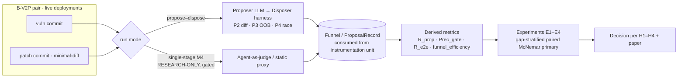
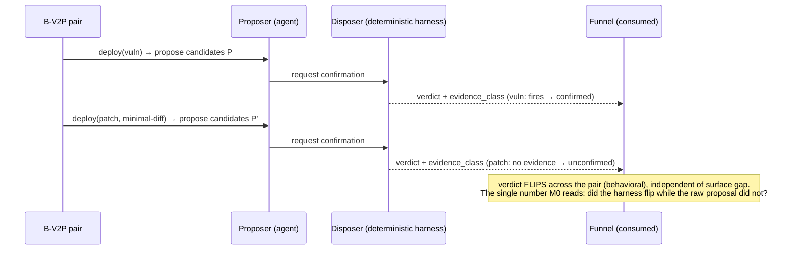

# Propose–Dispose Validation — Specification

> Spec-Architect PBT variant · Feature **F-PD-B** · `type: research` · **parallel track, non-gating to product milestones**.
> Validates the propose–dispose thesis on real targets: a non-generative disposer decouples recall (proposer) from precision (gate), breaking the single-stage precision/recall trap. Consumes the `propose-dispose-instrumentation` unit + phase artifacts; builds neither funnel nor assembler.
> Canonical research narrative + full method/threats/paper framing: companion `../paper/propose-dispose-research-proposal-v0.4.md` (placed 2026-06-18; referenced from `planning/requirements.md`). Source: v0.4 + PM stats/positioning reviews. Program index: `specs/README.md`.

---

## Goal

Empirically confirm or refute that strix's *agent-proposes / harness-disposes* architecture **breaks the precision/recall trade** that single-stage and LLM-critic detectors are stuck on, by measuring it on **Behavioral-V2P (B-V2P)** pairs — the same application deployed at a vulnerable commit and its security-fix commit, run live. Success = the experiment suite (E1–E4) produces a decision on each hypothesis (H1–H4) under pre-registered tests, with the load-bearing results being: **`Prec_gate` stays ≈ constant as proposal recall is pushed (H1)**, and **strix's pipeline beats a single-stage proxy on small-gap pairs (H2a)** — establishing that strix **escapes the false-positive arm of gap-dictation while the false-negative arm remains the proposer's recall problem** (H2b/H3). The honest, non-over-claiming framing is the deliverable, not a flat "escapes the trap."

---

## Architecture Overview

---

## User Stories

- **As the research program**, I run strix against a B-V2P pair (vuln vs. its minimal-diff patch) so I can test whether the *harness* — not the model — flips its verdict across the pair.
- **As the research program**, I sweep proposal aggressiveness and watch `Prec_gate` so I can prove (or refute) that pushing recall does not leak into confirmation precision (H1).
- **As the research program**, I compare the strix pipeline against a single-stage proxy on small-gap pairs via paired McNemar so I can show the false-positive-arm win (H2a) without over-claiming.
- **As the research program**, I measure proposer recall against the surface gap so I can locate the inherited false-negative arm honestly (H2b) and tie it to the recall ceiling (H3).
- **As the operator**, the single-stage ablation mode that lets the agent self-confirm is build-time/entrypoint gated and proven off in production, so research apparatus can never become a live locus-1 failure.
- **As the architecture's safety invariant**, the disposer is never modified and the gate can only remove proposals, never add findings — so precision is never owned by a model.

---

## Specific Requirements

### Functional

| # | Requirement | Success criteria |
|---|---|---|
| F-1 | **B-V2P benchmark corpus.** Same app at {vuln-commit, patch-commit}, deployed live. | Small-gap-biased; each pair ships ground-truth `V`, is dockerized, and is minimal-diff (curate or synthesize a single security-logic change); ≥1 per primitive — IDOR/BFLA (P1/P2), SSRF/XXE (P3) now; race (P4) and business-logic (P5) as soft edges. Small-gap discordant count is power-checked. |
| F-2 | **Funnel-derived metrics (consumed).** Read, don't re-derive. | `R_prop=|P∩V|/|V|`, `Prec_gate=|C∩V|/|C|`, `R_e2e`, `funnel_efficiency=harness_runs/|C|` computed off the instrumentation funnel log per run; cross-checked against the M0 hand-computation. |
| F-3 | **H1 — tradeoff break (E1).** Sweep proposal aggressiveness, both modes. | Single-stage shows recall↑/precision↓ (the trap); propose–dispose shows `R_e2e`↑ with `Prec_gate` ≈ constant. **Gate leakage (`Prec_gate`<1) is the primary watch.** Falsified if `Prec_gate` falls materially as `R_prop` rises. |
| F-4 | **H2a — false-positive-arm win (E2).** | **Primary:** gap-stratified paired McNemar (one-sided) — strix pipeline pairwise-correct > single-stage proxy (main effect). **Mechanism fingerprint (secondary, power permitting):** margin widens as surface gap shrinks. Difference-of-correlations + bootstrap CIs are illustrative only. Underpowered interaction is reported as such, not as falsification. |
| F-5 | **H2b — false-negative-arm limit (E2).** | Proposer recall is measured against the surface gap; a drop on small-gap pairs demonstrates the inherited FN (gate is neutral → not rescued). Each pair is decomposed into FP-arm (patched side) and FN-arm (vuln side) so H2a/H2b cannot confound. Flat recall across the gap = a stronger result. |
| F-6 | **H3/H3b — intervention ablation (E3).** Full vs −Control vs −Knowledge vs −Checklist. | Two readouts per condition: (a) `R_prop` overall + per FN-category (C5/Knowledge, C6-C7/Checklist, C3/Control) — H3; (b) `funnel_efficiency` with C1-attributed FP-proposal rate broken out — H3b. |
| F-7 | **H4 — perturbation invariance (E4).** | Semantic-preserving perturbations of the live target's responses leave strix verdicts invariant; the static proxy degrades. |
| F-8 | **Single-stage ablation mode (M4).** Research baseline only. | Harness-disabled baseline (agent self-confirms) + static-proxy (optional LLM-critic) baseline; **build-time/entrypoint gated, never a runtime toggle**; an off-in-prod regression test must pass; dynamic range matched to avoid the floor-effect confound. |
| F-9 | **M0 walking skeleton + seed assignment.** | Discriminator = **open-webui IDOR (CVE-2024-7041)** via a synthesized minimal one-line ownership-check patch (no clean public single-commit fix exists; both CVE IDs verified real). H1/OOB showcase = **Flowise SSRF (CVE-2026-31829, ≤3.0.12 → 3.0.13)**. Readout: *did the harness flip vuln→fixed while the raw proposal did not?* |

### Non-Functional

| Aspect | Requirement |
|---|---|
| **Gate neutrality (architecture invariant)** | `C ⊆ P`: the gate only removes proposals, never adds findings; the disposer is never modified. Precision is owned by the harness, recall by the proposer — the property that breaks the trade. |
| **Pre-registration (research validity)** | E2's gap metric, primary test, and equivalence margin `δ` are registered before any outcome is observed. |
| **Recall semantics** | Recall reported as *recall-over-known-labels* with the explicit unknown-unknown caveat; never an absolute-recall claim. |
| **No imported magnitudes** | The single-stage baseline is self-measured; the cited papers' FPR/ρ/F1 establish the trap's *shape*, not its coordinates in this regime. The C1–C8 taxonomy is an LLM-as-judge artifact ("targets C5" = "the C5-described failure mode"). |
| **Corpus power** | Small-gap-biased, not dozens-spanning; the McNemar-primary design needs *discordant* small-gap pairs, not breadth. No tight ρ reported from tiny n. |
| **Non-gating** | The `propose-dispose-validated` milestone must never gate a product milestone; race/business-logic experiments are soft-edged behind Phases 4/5. |
| **M4 safety (locus-1)** | The self-confirm mode is the one piece touching the forbidden path; it is quarantined in this spec, never enters the product DAG, and is never a runtime config. |
| **Transparency (glass-box)** | Every claim traces to a funnel artifact; the deterministic disposer is inspectable; the agent proposes, the harness disposes. |
| **Self-hosting / no leak** | B-V2P targets run in the sandbox; OOB confirmation uses the self-hosted P3 oracle; no target data leaves to a third party. |

---

## PBT Validation Strategy

This is a **measurement track**: most deliverables are experiments validated under the research-validity gate (pre-registration + recall-over-known + no-imported-magnitudes), not PBT'd software. Only the *software* this spec adds — the M4 ablation mode — carries hard tiered validation.

**Tier-1 focused testing:** the M4 ablation mode is off in the production configuration; a B-V2P pair builds correctly from a fixture (vuln side exploitable, patch side not); the four funnel metrics computed off a synthetic funnel match the M0 hand-computation.

**Tier-2 Property-Based Testing** (security-critical, deterministic): the **M4 production-off guardrail** and **gate neutrality** are the PBT targets — validated against synthetic configs/funnels with no live agent. These are the locus-1 guarantees and gate the spec's only shippable software.

**Validation timeline:** Tier-1 during M0/M4 build → Tier-2 PBT on the M4 guardrail + gate-neutrality invariants → research-validity gate (pre-registration) before E1–E4 outcomes are read.

---

## Security Properties to Validate (∀ invariants)

PBT-validated where marked **[PBT]**; research-validity invariants where marked **[RV]**.

1. **M4 production-off** **[PBT]** — `∀ production config: single_stage_ablation_mode = OFF ∧ no production entrypoint can reach the self-confirm path`. (The locus-1 guardrail in code; M4 does not ship without it.)
2. **Gate neutrality / no self-confirm** **[PBT]** — `∀ confirmation c: c ∈ proposals P ∧ c carries evidence_class ≠ none from a deterministic harness`. (`C ⊆ P`; the disposer never invents a finding; precision is never owned by a model.)
3. **Funnel completeness (inherited)** **[PBT]** — `∀ proposal p that reached a harness: ProposalRecord(p) carries ≥1 verdict + evidence_class`. (Consumed from the instrumentation unit; the metrics' substrate is never dropped.)
4. **No third-party leak** **[PBT]** — `∀ B-V2P target run: confirmation uses the self-hosted P3 oracle ∧ no target data leaves to an external service`. (Inherits Phase 2 self-hosting.)
5. **Recall-over-known integrity** **[RV]** — `∀ reported recall R: R is computed over labeled V only ∧ carries the unknown-unknown caveat`.
6. **Pre-registration integrity** **[RV]** — `∀ E2 statistical claim: its gap metric, test, and δ were registered before outcomes were observed`. (Anti-p-hacking.)

---

## Existing Code to Leverage

- `propose-dispose-instrumentation` (`unit`) — `funnel_log` + `proposal_context_assembler`: **consumed**, never rebuilt here.
- `strix/report/state.py` — the impact gate; the `Prec_gate` source. **Unmodified** (gate-neutrality invariant).
- `strix/core/diff/` (P1 `differential_engine`) — the IDOR/authz disposer for the M0 seed + IDOR/BFLA B-V2P pairs.
- `strix/tools/oob/` + `strix/core/oob/` (P2 `inject_confirm_tool`) — the SSRF/XXE disposer for the H1/OOB showcase pair.
- `strix/core/inventory/` (P3 `reachability_seam`, `parameter_classifier`) — feed the assembler context (via the instrumentation unit), and the E3 ablation readouts.
- `strix/runtime/docker_client.py` + `session_manager.py` — B-V2P live-deployment lifecycle (deploy vuln/patch commits as sandboxed targets).
- **M0 seed targets:** open-webui (CVE-2024-7041, `memories.py` `/api/v1/memories/{id}/update` IDOR) — synthesized minimal patch; Flowise (CVE-2026-31829, HTTP Node SSRF, ≤3.0.12 → 3.0.13).
- VulTriage (arXiv 2605.09461) Appendix C — paired **McNemar** = the E2 primary-test template; its Control Path = the assembler design (built in the instrumentation unit).
- Semantic Trap (arXiv 2601.22655) Table V (C1–C8) + Finding 5 (FP-drivers C1/C2 vs FN-drivers C5/C6) — the targeting rationale and the trap under test; **note the taxonomy is an LLM-as-judge artifact.**
- `tests/test_core_paths.py` — Tier-1 regression pattern to mirror for the M4 off-in-prod guardrail test.

---

## Out of Scope

- **Building the funnel or the assembler** — that is the `propose-dispose-instrumentation` unit; this spec only *consumes* them.
- **Any change to the disposer or new evidence classes** — the precision-owning stage (P2 diff / P3 OOB / P4 race / impact gate) is untouched; the gate-neutrality invariant forbids it.
- **M4 self-confirm mode in the product DAG** — never; it is quarantined here, off in prod, never a runtime toggle.
- **A dozens-spanning corpus** — McNemar-primary dissolves the breadth requirement; the corpus is small-gap-biased instead.
- **Product gating** — `propose-dispose-validated` is non-gating; it measures the engine, it is not a capability the product needs to ship.
- **Race / business-logic B-V2P pairs + their experiments** — soft-edged behind Phase 4 (`race_harness_tool`) and Phase 5 (`business_logic_orchestrator`); they do not block the core H1/H2 work on IDOR/SSRF.
- **Exploitation beyond confirmation** — the harness confirms a flaw fired; weaponization/chaining is the operator's call.

---

## Quality Gate 1 (design-principle alignment)

| Question | Answer |
|---|---|
| Enhances human capability? | Yes — it measures and raises the engine's reach (proposal recall) while keeping confirmation evidence-gated; it amplifies the operator's judgment of what the engine actually catches, never replaces it. |
| Supports focus / avoids distraction? | Yes — impact-gating + funnel efficiency keep attention on confirmed, evidence-backed findings; over-proposal cost is *measured*, never shipped as noise. |
| Transparent (glass-box)? | Yes — every claim traces to a funnel artifact; the disposer is deterministic and inspectable; gate neutrality (`C ⊆ P`) is enforced in code, and the M4 self-confirm path is provably off in production. |

**Gate 1: PASS.** Proceed to tasks (already drafted: `tasks.md` maps M0–M5 to task groups; only M4's off-in-prod guardrail carries a hard software gate, the rest are research deliverables under the research-validity gate).
