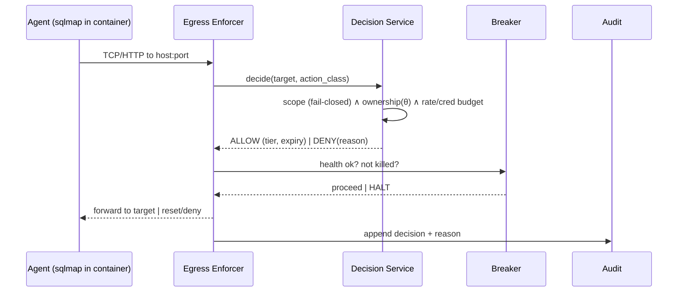

# Strix Governance Layer (SGL) — Specification

> Phase 2 output. Scannable, WHAT-not-HOW. Detail/rationale in `planning/requirements.md`;
> tasks in `tasks.md`. **Quality Gate 1: PASS.** Grounded in the pt-act/strix fork audited
> in `../agentic-redteam-harness/strix-vs-arth-assessment.md`.

---

## Goal

Add a deterministic safety/governance layer to the Strix fork so the engine can run
autonomously against authorized scope **without a human watching** — fail-closed scope,
ownership-aware authorization, rate/credential guardrails, target-health breaker +
kill-switch, cost governance, and cross-engagement sanitized memory — while leaving the
detection engine and its propose–dispose verdicts **byte-identical**.

**Measurable objectives**
- 100% of network egress (incl. shell-spawned tools) passes a fail-closed decision; **0**
  bypass paths.
- Default flips from fail-open to **fail-closed** (no scope rules ⇒ deny, not allow).
- **Gate-neutrality**: for SGL-allowed actions, the confirmed-finding set is identical with
  and without SGL.
- Automatic halt on target degradation; operator kill-switch effective mid-action.
- Zero out-of-scope actions and zero destructive actions under normal operation.

---

## Architecture Overview

```mermaid
graph TD
    OP[Operator] -->|signed scope + authz tier| DS[Govern: Decision Service]
    OP -->|kill-switch| CB
    OP -->|budgets / value policy| GOV[Govern: Cost & Value Governor]

    subgraph Sandbox container (production image, G1)
      AG[Strix agent + multi-agent graph]
      AG -->|HTTP| CAIDO[Caido proxy]
      AG -->|shell tools: nmap/sqlmap/nuclei/curl| EE
      AG -->|browser| EE
      CAIDO --> EE[Egress Enforcer  default-deny + mandatory proxy]
    end

    EE -->|every egress consults| DS
    DS --> SCOPE[scope rules  fail-closed]
    DS --> OWN[ownership attribution θ]
    DS --> LIM[rate / per-host budget / cred cap + lockout]
    DS -->|ALLOW| TARGET[(authorized target)]
    DS -->|DENY/UNKNOWN/EXPIRED| BLOCK[blocked + logged]

    AG --> COORD[AgentCoordinator]
    COORD --> CB[Circuit Breaker + Kill-Switch]
    CB -->|halt active actions| EE
    GOV -->|budget exhausted ⇒ halt| COORD

    AG --> MEM[Govern: Memory  per-engagement + sanitized shared]
    MEM --> RED[redaction / sanitizer wall]

    DS & CB & GOV & MEM --> AUD[(Governance Audit Log)]

    AG -. unchanged .-> ENGINE[Detection engine: propose-dispose evidence gate, OOB, identity/diff, race, logic]
    ENGINE -. SGL is gate-neutral .-> ENGINE
```

**The core idea:** the enforcement substrate is the **container egress boundary**, not the
app layer. Because the agent shells out (nmap/sqlmap/nuclei/curl) and drives a browser,
gating only at Caido leaves those paths open (the audit's central finding). The **Egress
Enforcer** (default-deny iptables + a mandatory enforcing proxy) sits at the container
boundary so *all* traffic — HTTP, raw sockets, DNS — consults the deterministic **Decision
Service** before leaving. Caido remains inline for HTTP semantics and consults the same
service. The detection engine is untouched and SGL is provably gate-neutral.

---

## User Stories

- As an **operator**, every active action (including shelled-out tools) clears a fail-closed
  scope decision, so an unattended run cannot touch an out-of-scope asset.
- As an **operator**, a kill-switch and an automatic degradation halt stop a misbehaving run
  without me.
- As a **researcher**, SGL is proven gate-neutral, so the propose–dispose paper's metrics
  are uncontaminated by the hardening.

---

## Acceptance Criteria

### Functional

- **AC-G1 Production image:** the image builds with all pinned tools **and** the egress
  enforcer active (default-deny); no tool can reach the network except through it.
- **AC-G2 Fail-closed scope:** any egress to a host/IP/URL executes only on a positive,
  fresh ALLOW from the decision service; DENY/UNKNOWN/EXPIRED/no-rules blocks and logs.
- **AC-G3 Ownership:** a discovered asset below θ ownership confidence resolves to
  needs-approval / not-authorized at the decision service.
- **AC-G4 Rate/cred:** per-host request budgets and per-route credential caps are enforced
  deterministically with lockout-aware backoff; bursts beyond budget are blocked, not
  delayed-then-sent past cap.
- **AC-G5 Breaker/kill:** on target-health breach the breaker halts active actions and
  requires operator ack to resume; the kill-switch halts in-flight actions including async
  OOB probes.
- **AC-G6 Cost:** token/tool-call/spend ceilings enforced (beyond `max_turns`); the work
  queue is ordered by expected value; exhaustion halts active work.
- **AC-G7 Memory:** only generalized, secret-free technique patterns cross to the shared
  tier; program-specific data stays engagement-scoped and is purged at retention; known
  issues suppress duplicates.
- **AC-G8 Gate-neutral:** for any action SGL allows, the propose–dispose verdict and
  confirmed set are identical to a run without SGL (no new confirmations, none removed
  except by SGL blocking the action upstream).
- **AC-G9 Audit:** every allow/deny/halt decision is logged with reason and is replayable.

### Non-Functional
- Fail-closed on every error path; egress completeness (0 bypass); deterministic enforcement
  (no LLM in path); additive to the fork (no engine edits); bounded per-request overhead.

---

## Technical Design

### Components (new `strix/core/govern/` unless noted)

| Component | Responsibility | Strix touch-point |
|-----------|----------------|-------------------|
| **Egress Enforcer** | Container-boundary default-deny + mandatory proxy; routes every egress through the decision service | production image (G1), `runtime/docker_client.py`, `containers/` |
| **Decision Service** | Single deterministic chokepoint: ALLOW/DENY + reason + authz tier + expiry; fail-closed | `govern/scope.py` (generalizes `_scope.py`) |
| **Ownership Attribution** | ASN/CIDR/whois → org-ownership confidence; feeds decision service | `govern/ownership.py`, `core/inventory/` |
| **Limiter** | Per-host rate budgets, credential caps, lockout-aware throttle | `govern/limiter.py`, `core/inventory/spray.py` |
| **Circuit Breaker + Kill-Switch** | Health monitor → auto-halt; operator emergency stop | `core/agents.py` (`AgentCoordinator`) |
| **Cost & Value Governor** | Token/tool-call/spend ceilings + expected-value queue ordering | `core/inputs.py`, `core/execution.py`, `config/` |
| **Memory** | Per-engagement ledger + sanitized shared technique library + dedup registry | `tools/notes/`, `report/state.py`, extends `core/identity/redaction.py` |
| **Governance Audit Log** | Append-only record of every decision/halt with reason | `telemetry/logging.py`, `report/state.py` |

### Decision flow (representative shelled-out tool)



### Interface contract (the chokepoint)

```python
# strix/core/govern/scope.py  — every egress path calls this; fail-closed.
def decide(target: Target, action_class: ActionClass, ctx: EngagementCtx) -> Decision:
    """Decision(verdict: ALLOW|DENY, reason, authz_tier, expires_at).
    DENY on: out-of-scope, ownership<θ, rate/cred exceeded, breaker tripped,
    killed, no rules loaded, expired, or any internal error."""
```

---

## Gate-neutrality (the invariant that protects the paper)

SGL may only **remove** actions upstream of the engine (by blocking egress); it may never
alter a disposition. Formally, for the set of actions A and SGL's allowed subset A' ⊆ A:
- `confirmed(A' with SGL) = confirmed(A') without SGL` — the disposer is byte-identical.
- SGL adds **no** `evidence_class` and touches **no** code under `core/logic/`,
  `core/proposals/`, `core/oob/`, `core/diff/`, `core/race/`. Verified by SP8 + a diff test.

---

## PBT Validation Strategy (Hypothesis / Python)

Security-critical properties (full defs in `pbt-properties.py`):

1. **SP1 scope soundness** — executed egress ⇒ decision ALLOW.
2. **SP2 fail-closed** — DENY/UNKNOWN/EXPIRED/ERROR/no-rules ⇒ blocked.
3. **SP3 egress completeness** — no egress path (shell/browser/Caido/DNS) bypasses the enforcer.
4. **SP4 rate/cred bound** — per-host ≤ budget; cred attempts ≤ cap/route/window.
5. **SP5 ownership gating** — ownership < θ ⇒ not ALLOW.
6. **SP6 breaker/kill** — health breach ∨ kill-switch ⇒ no further active action.
7. **SP7 cost bound** — spend ≤ ceiling; exhaustion ⇒ halt.
8. **SP8 gate-neutrality** — confirmed set identical with/without SGL for allowed actions.
9. **SP9 memory sanitization** — no shared-tier record carries client/secret data.
10. **SP10 audit completeness** — every decision ⇒ audit entry.

**Zero-tolerance (release-blocking):** SP1, SP2, SP3, SP6, SP8.

---

## Out of Scope
Detection-engine changes; B-V2P evidence gathering / paper experiments (deferred, §10
requirements); new attack capabilities; evasion/anti-forensics; autonomous scope expansion.

---

## Quality Gates
- [ ] **Gate 1 — Alignment:** authorization-first, glass-box, engine-integrity. (PASS)
- [ ] **Gate 2 — Focused tests:** per-group example tests pass.
- [ ] **Gate 3 — PBT:** SP1–SP10 hold under generated inputs.
- [ ] **Gate 4 — Security audit:** manual review of egress-bypass, ROE edge cases, race conditions on a pre-validated layer.
- [ ] **Gate 5 — Secured-engine smoke (pre-paper):** on authorized lab targets, the hardened engine runs end-to-end with 0 bypass / 0 out-of-scope / 0 destructive, and gate-neutrality confirmed on a B-V2P pair. **This is the HOLD LINE; paper evidence gathering begins only after it passes.**
