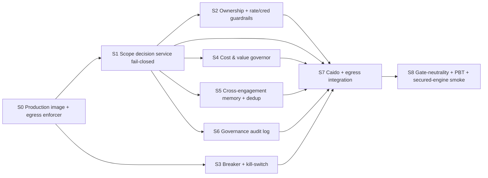

# Tasks — Strix Governance Layer (SGL)

> Phase 3 output. Dependencies, critical path, parallelization, tiered validation
> (Focused → PBT/Hypothesis). Estimates in **iterations**. Grounded in real fork modules.
> ⭐ = audited safety gap (highest priority).

## Status legend
`[ ]` not_started · `[~]` in_progress · `[x]` completed · `[-]` blocked

---

## Overview

| | |
|---|---|
| Task groups | 9 (S0–S8) |
| Total subtasks | ~46 |
| Critical path | S0 → S1 → S2 → S7 → S8 |
| Sequential estimate | ~22 iterations |
| Parallelized estimate (3 tracks) | ~14 iterations |
| PBT properties | SP1–SP10 (Hypothesis) |
| Paper evidence | **deferred** — separate downstream phase after S8 / Gate 5 |

**Build order rationale:** S0 (production image + egress substrate) is the enforcement
foundation; S1 (fail-closed scope service) is the chokepoint everything else feeds. They
are the two audited safety gaps and are built first. S8 proves gate-neutrality before the
HOLD LINE.

---

## Dependency Graph

**Critical path:** S0 → S1 → S2 → S7 → S8. **Bottleneck:** S0 (image/egress substrate is
infra-heavy) and S7 (integration across all egress paths).

---

## Parallelization Strategy (3 tracks)

| Track | Owns | Notes |
|-------|------|-------|
| **A (substrate/scope)** | S0 → S1 → S2 | The audited gaps; gates everything. |
| **B (lifecycle/cost)** | S3, S4 | Start after S0/S1 interfaces stub out. |
| **C (memory/audit)** | S5, S6 | Independent; converge at S7. |

Converge at **S7** (integration) then **S8** (validation + HOLD LINE).

---

## S0 — Production Sandbox Image + Egress-Enforcement Substrate ⭐
**Depends on:** none · **Replaces the minimal `strix-sandbox:dev`**
**Acceptance:** AC-G1; property SP3 foundation.

- [ ] 0.1 Full Kali image: pin all tools (nmap, nuclei + templates, sqlmap, ffuf, katana, httpx, naabu, subfinder, zaproxy) with versioned layers
- [ ] 0.2 Egress enforcer: default-deny iptables/nftables in the container; only the enforcing proxy may egress
- [ ] 0.3 Mandatory enforcing proxy (transparent) that ALL traffic traverses (HTTP, raw TCP, DNS); calls the decision service (S1)
- [ ] 0.4 Wire image into `runtime/docker_client.py` + `scripts/docker.sh` (`prod` target); keep `dev` for fast iteration
- [ ] 0.5 Health/build CI target (`./scripts/docker.sh ci` parity)
- **Validation Tier 1 (Focused):** 0.6 image builds + tool smoke (2) · 0.7 egress blocked without ALLOW, shell `curl` to arbitrary host fails closed (2)
- *Estimate: 5 iterations*

## S1 — Fail-Closed Scope & Authorization Decision Service ⭐
**Depends on:** S0 (interface), can stub egress
**Acceptance:** AC-G2; properties SP1, SP2.

- [ ] 1.1 `govern/scope.py` `decide(target, action_class, ctx) -> Decision` (ALLOW/DENY + reason + tier + expiry)
- [ ] 1.2 Generalize `_scope.py` rules; **flip default to fail-closed** (no rules ⇒ DENY)
- [ ] 1.3 Signed engagement scope ingestion (host/IP/CIDR/URL resolver)
- [ ] 1.4 Authz tiers + high-impact gating hook (exploit/credential classes)
- [ ] 1.5 Decision freshness/expiry; error paths ⇒ DENY
- **Validation Tier 1 (Focused):** 1.6 allow/deny resolution (3) · 1.7 no-rules ⇒ deny (1)
- **Validation Tier 2 (PBT):** 1.8 SP1 scope soundness · 1.9 SP2 fail-closed
- **Security Readiness:** 1.10 no LLM in decision path; not reachable/mutable from agent tools
- *Estimate: 4 iterations*

## S2 — Ownership Attribution + Rate / Credential Guardrails ⭐
**Depends on:** S1
**Acceptance:** AC-G3, AC-G4; properties SP4, SP5.

- [ ] 2.1 `govern/ownership.py` — ASN/CIDR/whois → ownership confidence; θ=0.80 default
- [ ] 2.2 Ownership feeds `decide()` (below θ ⇒ not ALLOW)
- [ ] 2.3 `govern/limiter.py` — per-host rate budget (10 rps), honors Retry-After/backoff
- [ ] 2.4 Credential cap (3/route/window) + lockout-aware throttle; integrate `core/inventory/spray.py`
- **Validation Tier 1 (Focused):** 2.5 ownership below-θ rejected (2) · 2.6 cred cap under burst (2)
- **Validation Tier 2 (PBT):** 2.7 SP4 rate/cred bound · 2.8 SP5 ownership gating
- *Estimate: 3 iterations*

## S3 — Target-Health Circuit Breaker + Operator Kill-Switch ⭐
**Depends on:** S0
**Acceptance:** AC-G5; property SP6.

- [ ] 3.1 Health monitor: error-rate >25%/20 reqs OR p95 >3× baseline → trip
- [ ] 3.2 Breaker halts active actions; operator-ack required to resume
- [ ] 3.3 Kill-switch into `AgentCoordinator` (extends `request_stop`/`cancel_descendants`) — halts in-flight incl. async OOB probes
- **Validation Tier 1 (Focused):** 3.4 breaker trips + halts (2) · 3.5 kill mid-action (1)
- **Validation Tier 2 (PBT):** 3.6 SP6 breaker/kill
- *Estimate: 2 iterations*

## S4 — Cost & Value Governor
**Depends on:** S1
**Acceptance:** AC-G6; property SP7.

- [ ] 4.1 Token/tool-call/spend accounting (beyond `max_turns`) in `core/execution.py`
- [ ] 4.2 Ceilings: 5M tokens + 10k tool-calls/engagement; 80% backpressure, 100% halt
- [ ] 4.3 Expected-value ordering of the agent-graph work queue (severity × likelihood × tier ÷ cost)
- **Validation Tier 1 (Focused):** 4.4 budget exhaustion halts (2)
- **Validation Tier 2 (PBT):** 4.5 SP7 cost bound
- *Estimate: 2 iterations*

## S5 — Cross-Engagement Memory + Program-Aware Dedup
**Depends on:** S1
**Acceptance:** AC-G7; property SP9.

- [ ] 5.1 Per-engagement ledger (extends `tools/notes/` + `report/state.py`)
- [ ] 5.2 Sanitized shared technique library; sanitizer extends `core/identity/redaction.py`
- [ ] 5.3 Program-aware known-issues registry + dedup at report emit
- [ ] 5.4 90-day engagement retention/purge
- **Validation Tier 1 (Focused):** 5.5 dedup suppresses known (2) · 5.6 sanitizer strips secrets/hosts (2)
- **Validation Tier 2 (PBT):** 5.7 SP9 memory sanitization
- *Estimate: 3 iterations*

## S6 — Governance Audit Log
**Depends on:** S1
**Acceptance:** AC-G9; property SP10.

- [ ] 6.1 Append-only decision log (allow/deny/halt + reason) via `telemetry/logging.py`
- [ ] 6.2 Replay reader; link decisions to actions
- **Validation Tier 1 (Focused):** 6.3 every decision logged (2)
- **Validation Tier 2 (PBT):** 6.4 SP10 audit completeness
- *Estimate: 1 iteration*

## S7 — Integration (all egress paths + gate-neutral wiring)
**Depends on:** S1–S6
**Acceptance:** AC-G2/G8 wiring; properties SP3, SP8 foundation.

- [ ] 7.1 Route Caido HTTP path through the decision service (`tools/proxy/`)
- [ ] 7.2 Confirm shell + browser egress traverse the enforcer (no app-layer bypass)
- [ ] 7.3 Breaker/kill + governor wired into `AgentCoordinator` + agent loop
- [ ] 7.4 Assert SGL touches NO `core/logic/`, `core/proposals/`, `core/oob/`, `core/diff/`, `core/race/` (import-boundary test)
- **Validation Tier 1 (Focused):** 7.5 end-to-end allow/deny across all egress types (3)
- *Estimate: 3 iterations*

## S8 — Gate-Neutrality + PBT Suite + Secured-Engine Smoke (HOLD LINE)
**Depends on:** S7
**Acceptance:** AC-G8; property SP8; Gate 5.

- [ ] 8.1 Full PBT suite SP1–SP10 green; zero-tolerance SP1/SP2/SP3/SP6/SP8 = 0 counterexamples
- [ ] 8.2 Gate-neutrality test: confirmed set identical with/without SGL on a B-V2P pair (engine verdict must still flip across vuln/fixed; SGL must not change it)
- [ ] 8.3 Secured-engine smoke on authorized lab targets: 0 bypass / 0 out-of-scope / 0 destructive
- **Security Readiness:** 8.4 Gate 4 manual audit (egress-bypass hunt, ROE edge cases)
- *Estimate: 1 iteration*

---

## Critical-Path Estimate

| Group | Iter | Critical |
|-------|------|----------|
| S0 | 5 | ✅ |
| S1 | 4 | ✅ |
| S2 | 3 | ✅ |
| S7 | 3 | ✅ |
| S8 | 1 | ✅ |
| S3 | 2 | ⟂ Track B |
| S4 | 2 | ⟂ Track B |
| S5 | 3 | ⟂ Track C |
| S6 | 1 | ⟂ Track C |
| **Sequential** | **~22** | |
| **3 tracks** | **~14** | S3–S6 overlap the S0→S1→S2 chain |

---

## Definition of Done (SGL)

- [ ] S0–S8 complete; AC-G1…G9 met.
- [ ] Gate 2 (focused) + Gate 3 (SP1–SP10) pass; SP1/SP2/SP3/SP6/SP8 zero-tolerance clean.
- [ ] Gate 4 audit done; Gate 5 secured-engine smoke passes = **HOLD LINE reached**.
- [ ] Import-boundary test proves no detection-engine files changed (gate-neutrality).
- [ ] `completion-summary.md` written.

## Explicitly deferred (NOT part of SGL)
- B-V2P evidence gathering and propose–dispose paper experiments **E1–E4** — run **after**
  Gate 5, on the secured engine, using the fork's existing `benchmarks/bv2p/` +
  `report/proposals.py`. Tracked separately so SGL stays gate-neutral and the paper's
  metrics describe the hardened system.
